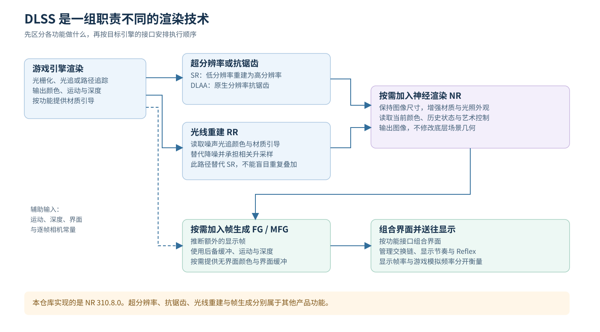
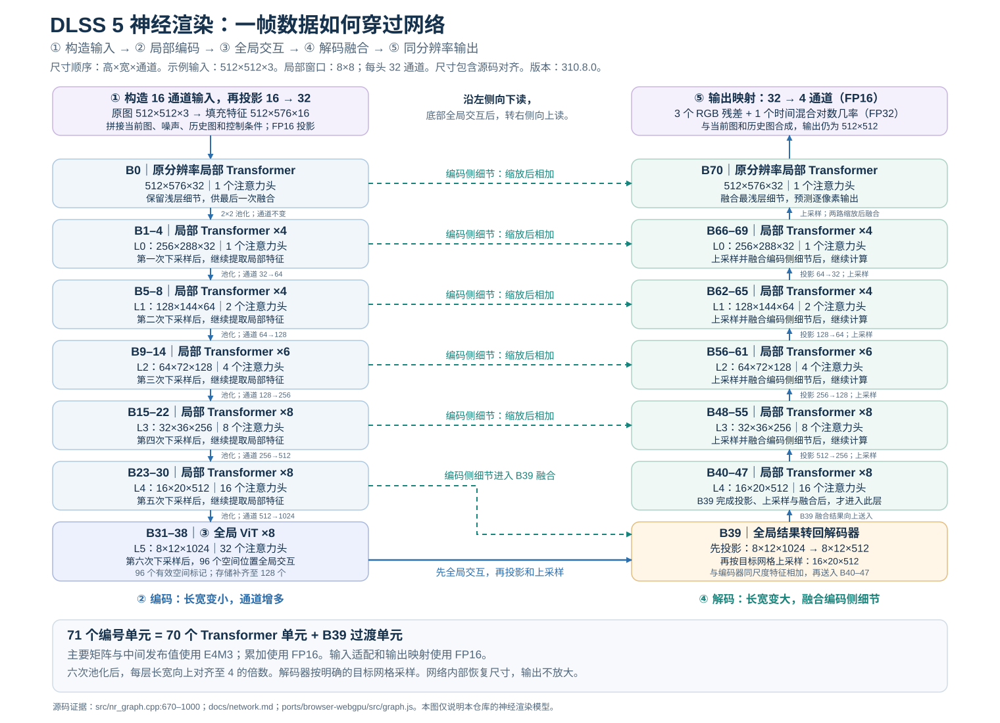
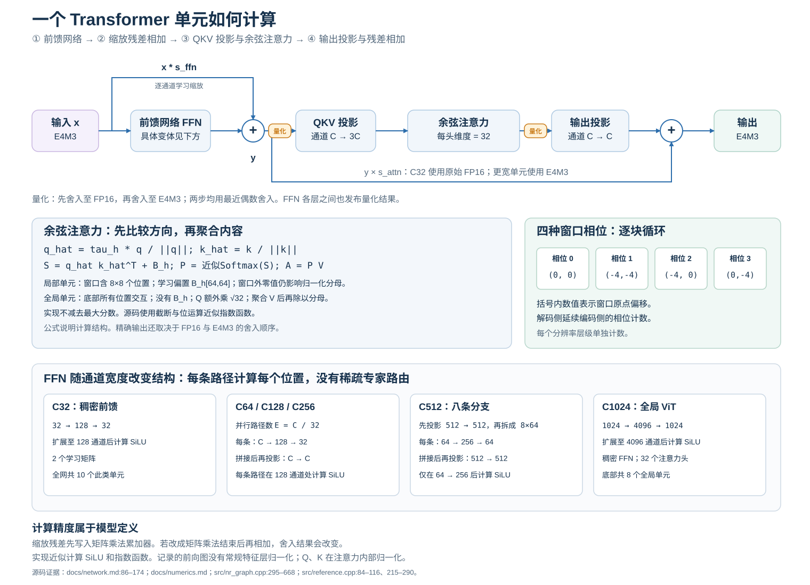
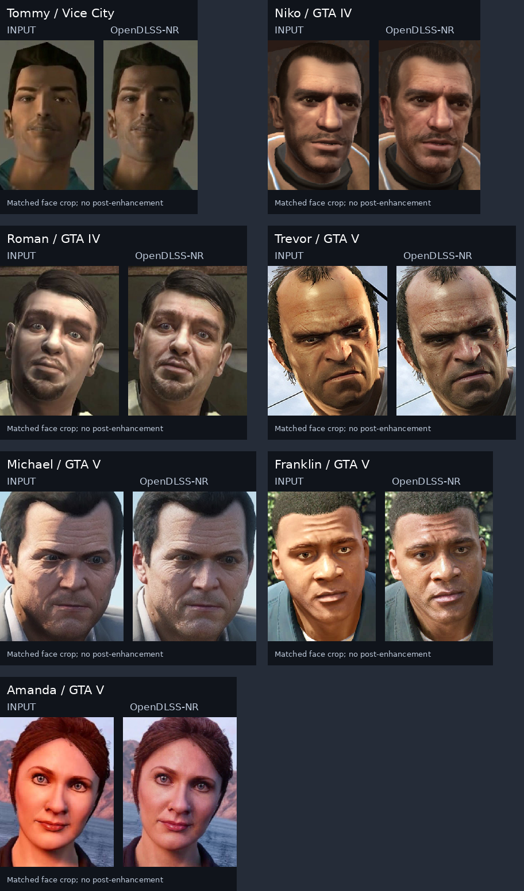

# DLSS 模型架构与产品调研报告

> 面向计算机视觉研究者的源码解读与产品调查。资料核查日期：2026 年 10 月 28 日。
>
> 仓库：`rrui05/open-dlss`，提交 `5cef97658735ef49daf048949e203d3f547699b8`。本文的逐层架构仅适用于仓库重建的 **DLSS 5 Neural Rendering 310.8.0**。

## 阅读结论

本仓库的名称容易造成误解。它实现的是 **DLSS 5 Neural Rendering，简称 NR**：给已经渲染出的图像补充摄影外观、材质和光照细节。它保持输入输出的有效分辨率。它没有实现 DLSS Super Resolution，简称 SR。不能用这里的 71 个编号单元解释 SR、Ray Reconstruction 或 Frame Generation 的内部网络。[仓库定位](../../README.md)

从计算图看，它是一个多尺度 Transformer U-Net。局部层使用 8×8 移位窗口，最底部使用 8 个全局 ViT 单元。通道从 32 扩展到 1024。输入包括当前帧的显示代理、噪声、重投影历史和控制条件。输出包括 RGB 残差与时间混合 logit。一个重要计数细节是：**71 个编号单元中，B39 只有尺度转换；完整 Transformer 单元为 70 个。**

从产品看，DLSS 已经是一组不同任务的组合。SR 改善空间采样效率，RR 重建稀疏光追信号，FG/MFG 增加显示帧，NR 改善外观。NR 自身增加推理开销，不能自动等同于“提高帧率”。它可以与前几种技术共同工作。

从研究看，必须区分三类正确性：数值复现是否一致、图像是否保留内容、外观是否更真实。三者没有相互替代关系。仓库的 bit-exact 检查回答第一类问题。它不直接回答后两类问题。

从版本看，仓库的 `310.8.0`、9 月官方论文约 154M 的模型、10 月官方约 118M 的产品模型是不同的观察对象。下面会分别标注。**仓库结构不是对最新产品全部内部实现的证明。**[10 月模型公告][S04]

## 术语与证据范围

| 术语 | 本文含义 |
| --- | --- |
| SR | Super Resolution；低分辨率多帧重建为高分辨率输出 |
| DLAA | 在原生分辨率执行 DLSS 抗锯齿 |
| RR | Ray Reconstruction；替代传统光追降噪器的学习式重建 |
| FG / MFG | Frame Generation / Multi Frame Generation；从引擎帧推断额外显示帧 |
| NR | Neural Rendering；本文特指 DLSS 5 的生成式外观增强 |
| proxy | 从渲染结果转换出的 LDR 显示代理，网络实际读取它 |
| field | 包含有效图像与填充区的网络计算网格 |
| token | 某一尺度上的一个空间位置及其通道向量 |
| head | 网络最后的 4 通道输出，不是 attention head |
| attention head | 固定 32 维的一组 Q、K、V 通道 |
| publication | 把中间值写到规定数值网格；其舍入是模型语义的一部分 |
| native | 仓库文档所对照的 NVIDIA 原始实现 |
| fixture | 固定输入及其参考中间值、head 或输出 |

本文用四种证据表达：**源码事实**来自当前提交；**官方说明**来自 NVIDIA 官方材料；**分析推导**由计算图推得；**仓库记录**指已有实验，不能冒充本次重跑。本次独立执行的检查集中列在第 10 节。

## 1 DLSS 家族分别解决什么问题

### 1.1 任务拆分

| 功能 | 主要问题 | 输入与输出的关系 | 核心效益 | 本仓库是否实现 |
| --- | --- | --- | --- | --- |
| SR | 用较低着色成本产生高分辨率图像 | 低分辨率输入 → 高分辨率输出 | 节约渲染成本 | 否 |
| DLAA | 原生分辨率抗锯齿 | 同分辨率输入输出 | 采样质量 | 否 |
| RR | 稀疏光追样本的降噪与重建 | 噪声光追颜色与材质引导 → 重建输出 | 光追细节与稳定性 | 否 |
| FG | 引擎渲染帧之间的显示采样不足 | 每个引擎帧对应额外生成帧 | 显示平滑度 | 否 |
| MFG | 同上，生成多帧 | 一个引擎帧对应多个显示帧 | 更高显示帧率 | 否 |
| Dynamic MFG | 场景负载变化下的倍率选择 | 按目标帧率调整生成数量 | 平衡平滑度与开销 | 否 |
| NR | 常规场景表示与实时渲染缺失的外观线索 | 当前渲染帧 → 同分辨率增强帧 | 摄影感、材质和照明外观 | 是，310.8.0 |

前六项的产品定义见 [NVIDIA DLSS 开发者页][S08]。NR 的定义见 [NVIDIA DLSS 5 研究页][S01]。这些功能不共享一个已经公开的完整计算图。

### 1.2 一个完整产品管线的概念图



这张图表示职责关系，不规定所有游戏的唯一调用顺序。典型情况下，SR/DLAA 占据抗锯齿或主升采样位置。RR 路径可以同时承担重建和升采样，不是先独立 RR、再无条件叠加一次 SR。官方 Streamline RR 指南明确指出，开启 RR 时会替代 SR 路径。[RR 指南][S13]

NR 处理渲染外观。FG/MFG 还涉及交换链、UI 分离和显示节奏。它们不能都简化为“在最终截图上跑一次网络”。UI 的组合顺序必须服从具体功能的集成契约。

### 1.3 用数学区分重建与生成

以下是任务抽象，不是 NVIDIA 未公开的训练公式。令 $I_t^L$ 为低分辨率渲染帧，$D_t$ 为深度，$M_t$ 为运动，$j_t$ 为抖动，$E_t$ 为曝光，$h_t$ 为历史状态。

SR 可以抽象为：

$$
(I_t^H,h_t)=F_{\rm SR}(I_t^L,D_t,M_t,j_t,E_t,h_{t-1}).
$$

它依靠亚像素抖动与跨帧对应补充采样信息。它不是单张 JPEG 放大算法。DLAA 对应输入输出尺寸相等的使用方式。

NR 则可以抽象为：

$$
(Y_t,h_t)=F_{\rm NR}(P_t,\mathcal W(h_{t-1},M_t),z_t,c_t).
$$

这里 $P_t$ 是当前显示代理，$z_t$ 是噪声，$c_t$ 是艺术控制。这个表达式贴近本仓库实际输入。$Y_t$ 与 $P_t$ 的有效尺寸相同。它补充统计外观先验，不以收敛路径追踪图为唯一目标。

## 2 本仓库 NR 网络的完整架构

<a id="classroom-walkthrough"></a>

### 2.0 跟着一张图像走完整个网络

这一节按图像流动的顺序讲。先把整体路线记住：**构造输入特征 → 多次下采样并提取局部特征 → 最低分辨率的全局 ViT → 多次上采样并融合跳连 → 输出残差与历史权重。** 下面所有三维尺寸统一写成“高×宽×通道”，不包含 batch。

**从一张 512×512 的彩色图像开始。** 它最初有 3 个颜色通道。网络不会立即把 RGB 缩小，而是先准备输入：当前图像的显示代理、重投影的历史颜色、三路噪声和控制条件。每个位置由此得到 16 个数。

为了满足内部计算的对齐规则，512×512 的有效区域扩展到 512×576 的计算区域。右侧额外区域不是新画面。它只是供网络计算使用的填充。于是，真正送入网络的张量是 **512×576×16**。

接着，一个输入投影把每个位置的 16 维向量映射为 32 维。空间位置数量不变，所以张量变成 **512×576×32**。B0 在这个分辨率上运行一个局部 Transformer 单元。这一步结束后，才开始第一次下采样。

**第一次下采样，把相邻 2×2 的位置求平均。** 高和宽各减半，通道暂时保持 32。张量从 512×576×32 变成 **256×288×32**。在这个尺寸上，B1–4 连续运行 4 个局部 Transformer 单元。它不是缩小之后立刻继续缩小，中间会先更新这一尺度的特征。

**第二次下采样，同时开始增加通道宽度。** 池化先把空间尺寸变成 128×144，随后线性投影把通道从 32 增加到 64。现在得到 **128×144×64**，再经过 B5–8 的 4 个局部 Transformer 单元。

这里必须区分两种“维度”。高和宽描述有多少个空间位置。通道数描述每个位置用多长的向量表示。编码器减少空间位置，同时增加向量宽度。池化是有损操作，增加通道并不自动保存原来的全部像素信息。

再往下走，网络重复“池化 → 通道投影 → 局部 Transformer”。完整的编码路线如下：

```text
512×576×32    B0：1 个局部单元
     ↓ 第 1 次池化
256×288×32   B1–4：4 个局部单元
     ↓ 第 2 次池化，再把通道 32→64
128×144×64   B5–8：4 个局部单元
     ↓ 第 3 次池化，再把通道 64→128
 64×72×128   B9–14：6 个局部单元
     ↓ 第 4 次池化，再把通道 128→256
 32×36×256   B15–22：8 个局部单元
     ↓ 第 5 次池化并对齐，再把通道 256→512
 16×20×512   B23–30：8 个局部单元
     ↓ 第 6 次池化并对齐，再把通道 512→1024
  8×12×1024  到达底部；接下来才运行全局 ViT
```

末两级的宽度并非严格减半。36 除以 2 得到 18，计算网格再补齐到 20；20 除以 2 得到 10，再补齐到 12。这些内部池化的额外列写零。它们不同于最开始原图扩展到 field 时的镜像填充。

**到这里还没有开始上采样。底部先连续运行 8 个全局 ViT 单元。** 输入空间网格是 8×12，共 96 个位置。每个位置带着一个 1024 维向量。因此，把空间位置展开后，可以把它理解成 **96×1024** 的 token 序列。这里的 96 个位置包含上述空间对齐位置。

前面的局部 Transformer 在每个 8×8 窗口内交换信息。到了底部，全局 ViT 让每个位置都可以参考全部 96 个位置。换句话说，它把其他区域的信息汇总到当前位置的表示中，让粗尺度特征带上全图上下文。这个解释来自信息连接范围，不代表某个 attention head 专门负责皮肤或光照。

每个 ViT 单元先运行 FFN。FFN 把每个位置的 1024 维向量暂时展开到 4096 维，经过非线性后再映射回 1024 维。这部分主要在每个位置内部组合通道信息。它不改变位置数。

随后运行全局注意力。Q、K、V 分别按 32 个头拆开，每个头中，每个位置有 32 维。于是，一个头会形成 **96×96 的位置关系矩阵**：第 i 个位置根据与其他位置的匹配程度，汇总它们的 V。32 个头的结果拼回 1024 维，再经过输出投影与残差相加。

这套计算连续重复 8 次。入口是 96×1024，出口仍然是 96×1024。恢复空间排布后，仍然是 **8×12×1024**。所以，**ViT 的任务是更新特征之间的全局关系；它本身没有把图像缩小或放大。** 实现中另有补到 128 行的存储对齐，它不增加空间网格的位置。

**8 个 ViT 单元结束后，B39 才启动解码。** 它先把通道从 1024 投影到 512。因此，8×12×1024 先变成 **8×12×512**。接着，它按 2 倍最近邻的索引关系生成 **16×20×512** 的目标网格。

为什么不是简单写成 16×24？因为解码器必须回到编码器这一层实际使用的 16×20。源码直接生成目标范围，相当于 2 倍复制后只保留对应区域，不必实际生成一个 16×24 的中间张量。

接下来，B39 取出编码器 B30 保存的 **16×20×512** 特征，乘学习缩放后加进来。两路特征的分工可以这样理解：上采样这一路携带底部交换过的全局信息；跳连这一路补回相同尺度的编码特征。这里使用加法融合，通道数仍然是 512。它不是把两路拼成 1024 通道。

融合完成后，B40–47 再运行 8 个局部 Transformer 单元。之后，解码器继续“减少通道 → 上采样到对应尺度 → 加入编码器跳连 → 局部 Transformer”。它沿下面的路线回去：

```text
  8×12×1024  8 个全局 ViT 的输出
     ↓ B39：先 1024→512，再上采样并加入跳连
 16×20×512   B40–47：8 个局部单元
     ↓ 512→256，上采样并加入跳连
 32×36×256   B48–55：8 个局部单元
     ↓ 256→128，上采样并加入跳连
 64×72×128   B56–61：6 个局部单元
     ↓ 128→64，上采样并加入跳连
128×144×64   B62–65：4 个局部单元
     ↓ 64→32，上采样并加入跳连
256×288×32   B66–69：4 个局部单元
     ↓ 上采样，并与 B0 保存的特征融合
512×576×32   B70：1 个局部单元
```

**最后，32 维特征才转换成输出。** 一个 32→4 投影产生 512×576×4。前三个通道告诉合成器怎样修改当前 RGB，第四个通道控制保留多少历史。合成器把 RGB 残差按 1/4 加回当前显示代理，再按预测权重融合历史。输出取原来的有效区域，得到 **512×512×3**。

所以，这条 U 形路径是：内部空间网格逐层变小，底部 ViT 交换全局信息，解码器结合跳连逐层回到原尺寸。最终仍是一张 512×512 的图。它的内部上采样服务于同分辨率神经渲染，不是把输入图像放大为更高分辨率。

这段讲解对应 [`src/nr_graph.cpp:722`](../../src/nr_graph.cpp) 的输入投影、[`src/nr_graph.cpp:745`](../../src/nr_graph.cpp) 的编码路径、[`src/nr_graph.cpp:583`](../../src/nr_graph.cpp) 的全局 ViT、[`src/nr_graph.cpp:853`](../../src/nr_graph.cpp) 的解码入口与 [`shaders/ops.comp:78`](../../shaders/ops.comp) 的采样规则。数值舍入和不同 FFN 的细节见后续小节。

### 2.1 总体结构图



图中的具体空间尺寸采用 **512×512 有效输入**。通道宽度与单元编号适用于该固定网络。换一个输入尺寸时，层数和通道不变，field 与各层空间尺寸重新计算。

证据：[网络文档](../network.md)，特别是第 7–29、76–84、176–198 行；[前向图](../../src/nr_graph.cpp)，特别是第 735、750、784、832、853、868、879、955 行。

### 2.2 各尺度与单元编号

| 尺度 | 512² 示例的空间尺寸 H×W | 通道 C | 编码器 | 解码器 | 注意力头数 |
| --- | --- | ---: | --- | --- | ---: |
| field | 512×576 | 32 | B0 ×1 | B70 ×1 | 1 |
| L0 | 256×288 | 32 | B1–4 ×4 | B66–69 ×4 | 1 |
| L1 | 128×144 | 64 | B5–8 ×4 | B62–65 ×4 | 2 |
| L2 | 64×72 | 128 | B9–14 ×6 | B56–61 ×6 | 4 |
| L3 | 32×36 | 256 | B15–22 ×8 | B48–55 ×8 | 8 |
| L4 | 16×20 | 512 | B23–30 ×8 | B40–47 ×8 | 16 |
| L5 | 8×12 | 1024 | B31–38 ×8，全局 ViT | 无 | 32 |

**B39 独立执行 `1024→512` 投影、2 倍最近邻上采样与 L4 跳连合并。** 它没有完整的 FFN 和 attention 运算。B40–47 才是该解码尺度的 8 个 Transformer 单元。[`src/nr_graph.cpp:853`](../../src/nr_graph.cpp)

实际计数为：C32 单元 10 个、C64 单元 8 个、C128 单元 12 个、C256 单元 16 个、C512 单元 16 个、全局 C1024 单元 8 个，总计 70 个。再加 B39，共 71 个编号单元。

这也解释了文档中“71-block network”的简称。报告保留该模型名称，但逐层分析采用实际执行语义。

### 2.3 为什么需要多尺度 U 形结构

以下是按计算图作出的分析。

高分辨率的 32 通道路径保留局部细节。逐层池化扩大感受野，同时把通道预算转移到低分辨率语义表示。跳连让解码器重新取得输入对应的空间细节。

局部窗口负责近邻交换。底部全局 attention 让远距离区域交换信息。例如，模型可以同时利用局部皮肤细节与全局照明上下文。不过，源码结构本身不证明某个语义能力的因果来源；这需要消融实验。

这不是标准 Swin 分类网络直接接一个放大头。它具有完整 U 形解码器、不同宽度的 FFN、独特残差缩放与时间混合输出。

### 2.4 真实输入的 16 个通道

输入形状是 FP32 `[Hf*Wf,16]`，输出形状是 FP32 `[Hf*Wf,4]`。批次在该实现中不是一个通用训练 batch 维度。

| lane | 输入 | 研究解释 |
| --- | --- | --- |
| 0–2 | 三路高斯噪声 | 由填充坐标与 seed 的哈希，经 Box–Muller 构造 |
| 3 | 常数 1 | 显式常数输入 |
| 4–6 | 当前 proxy RGB | 使用 `(code−0.5)/8`，并遵循 FP16 舍入 |
| 7–9 | 重投影后的上一帧输出 RGB | 与当前 proxy 使用同一中心化变换 |
| 10 | `style/128` | 风格条件 |
| 11 | `localTone` | 局部色调控制 |
| 12 | 自动 mask 开启时为 1，否则为 `localStructure` | 控制条件的一部分 |
| 13 | 自动 mask 开启时为 skin 条件，否则为 −1 | skin 为负时复用 structure |
| 14 | 自动 mask 开启时为 `localStructure`，否则为 −1 | 控制条件的一部分 |
| 15 | 常数 0 | 保留通道 |

证据：[`docs/network.md:10`](../network.md)、[`demo/shaders/nr_preprocess.comp:52`](../../demo/shaders/nr_preprocess.comp)、[`shaders/preprocess.comp:73`](../../shaders/preprocess.comp)。

**核心网络没有直接读取运动、深度、法线、反照率或对象 ID 的通道。** demo 的运动向量用于网络外的历史重投影。深度与对象 ID 参与渲染侧运动生成。不能把产品名“3D-Guided”改写成“网络输入完整 G-buffer”。

没有有效历史时，lane 7–9 复制当前 proxy。单图工具也采用这个约定。零运动与无历史是两种不同状态，不能互相代替。

### 2.5 输入适配器与输出头

输入适配器是 FP16 权重的 `16→32` 投影。随后进入 B0。最后 B70 的原始 FP16 输出经过 `32→4` 投影，写出 FP32 head。

输出 0–2 通道不是最终 RGB，而是残差。第 3 通道不是 alpha、depth 或置信度的通用标签，而是时间混合 logit。它由合成管线转为历史权重。

证据：[`src/nr_graph.cpp:735`](../../src/nr_graph.cpp)、[`src/nr_graph.cpp:955`](../../src/nr_graph.cpp)、[`docs/network.md:189`](../network.md)。

### 2.6 field 与 padding 是计算语义

令有效尺寸为 $W\times H$。各轴的层尺寸按下式递推：

$$
s_k=\operatorname{alignUp}\left(\left\lceil s_{k-1}/2\right\rceil,4\right),\quad k=0,\ldots,5,
$$

其中 $s_{-1}$ 是 field 的尺寸。不能简单把各层标成严格的 $H/2^k$。源码另按缩减次数计算 field 对齐，设置 320 的下限，并有一个条件成立时额外增加 field 宽度的规则。

| 有效尺寸 W×H | field，W×H | 最底部 L5，W×H | 全局空间位置数 |
| --- | --- | --- | ---: |
| 512×512 | 576×512 | 12×8 | 96 |
| 768×768 | 832×768 | 16×12 | 192 |
| 1920×1080 | 1920×1152 | 32×20 | 640 |
| 3840×2160 | 3840×2176 | 60×36 | 2160 |

ViT 存储的 token 数再补齐到 64 的倍数。因此 512² 示例具有 96 个有效 token，存储行数为 128。

两种边界必须分开理解。有效图像到 field 的填充使用镜像采样，噪声仍使用填充后的坐标。局部窗口越过 field 时，则读取零向量。后者的零 key/value 仍参与分母计算，不能直接替换为标准 attention mask。

极小尺寸还有实现边界。某些宽高组合要求额外 crop，但此端口没有实现该 crop，因此主动拒绝。文档给出的实用安全范围是每轴至少 33 像素。实际合法性以 `Geometry::fromValid` 为准。[`docs/network.md:31`](../network.md)、[`src/nr_graph.cpp:29`](../../src/nr_graph.cpp)

## 3 Transformer 单元内部怎样计算

### 3.1 先 FFN 再 attention



忽略量化时，单元的实数结构可以写为：

$$
y=s_{\rm ffn}\odot x+F(x),
$$

$$
x'=s_{\rm attn}\odot y+W_O\,A(W_Qy,W_Ky,W_Vy).
$$

这里 $s_{\rm ffn}$ 和 $s_{\rm attn}$ 是逐通道学习缩放。顺序是 **FFN→attention**。该前向图没有普通 Transformer 的 feature LayerNorm 路径。Q、K 的 cosine normalization 是另一件事。

实际 GEMM 把缩放后的 skip 放入初始累加器，而不是矩阵乘法结束后再加。FP16 累加下，这两种写法具有不同舍入。C32 单元还使用 raw FP16 的 FFN 结果作为 attention skip；更宽的单元使用其 E4M3 发布值。

证据：[`docs/network.md:86`](../network.md)、[`src/nr_graph.cpp:295`](../../src/nr_graph.cpp)、[`src/nr_graph.cpp:414`](../../src/nr_graph.cpp)。上述两式只解释结构，不承诺逐位等价。

### 3.2 FFN 随宽度改变

| 宽度 C | 结构 | 激活与分支 |
| ---: | --- | --- |
| 32 | `32→128→32` | 第一次投影后使用近似 SiLU |
| 64 / 128 / 256 | `E=C/32` 条并行 `C→128→32`，拼接后 `C→C` | 每条分支的第一次投影后使用近似 SiLU |
| 512 | `512→512`，8 条 `64→256→64`，拼接后 `512→512` | 只在 256 维中间层之后使用近似 SiLU |
| 1024 | `1024→4096→1024` | 稠密 ViT FFN |

代码把部分分支称为 `expert`。但每个 token 都运行全部分支，源码没有 router 或 top-k。因此，把它称为稀疏 MoE 会误解其计算量。更准确的描述是并行瓶颈分支与通道混合。[`docs/network.md:109`](../network.md)

激活不是直接调用标准 `silu(x)=xσ(x)`。参考实现使用有截断自变量的三次近似。令 $b=\operatorname{clip}(x,-4,4)$：

$$
\widetilde\phi(x)=x\left[b\left(-0.055908203125|b|+0.447265625\right)+0.89453125\right].
$$

外面的乘数仍为原始 $x$。中间操作逐次舍入到 FP16。换成库函数 SiLU，即使视觉接近，也不再满足本仓库的逐位复现目标。[`src/reference.cpp:111`](../../src/reference.cpp)

### 3.3 局部 attention 的 QK 归一化

每个 attention head 的维度固定为 32，head 数为 $C/32$。在结构层面：

$$
\widehat q_i=\tau_h\frac{q_i}{\|q_i\|_2},\qquad
\widehat k_j=\frac{k_j}{\|k_j\|_2},
$$

$$
S_{ij}=\widehat q_i^T\widehat k_j+B_{ij}^{(h)}.
$$

$\tau_h$ 是逐 head 学习温度。$B^{(h)}$ 是每 head 的 64×64 学习 prior，存为 FP16。不能未经证明就把它写成标准 Swin 使用的压缩相对位置偏置表。

这类 scaled cosine attention 限制了 logit 对 QK 范数的依赖。结合低精度与指数截断，它为 FP16 累加和 FP8 权重提供数值条件。这是对结构作用的解释，不等于一项独立消融结论。

证据：[`docs/network.md:120`](../network.md)、[`src/reference.cpp:215`](../../src/reference.cpp)、[`src/nr_model.cpp:209`](../../src/nr_model.cpp)。

### 3.4 指数与 softmax 不是标准库版本

逻辑上仍然是：

$$
P_{ij}=\frac{\widetilde{\exp}(S_{ij})}{\sum_{j'}\widetilde{\exp}(S_{ij'})},\qquad
O_i=\sum_jP_{ij}V_j.
$$

实现用 FP16 位模式构造近似指数。局部窗口使用：

$$
u=\operatorname{clip}\bigl(\operatorname{f16}(0.044921875s+1.30078125),1.03125,1.5693359375\bigr),
$$

再把 `(bits(u)<<5) XOR 0x8000` 解释为 half。它对应有效截断区间约为 −6 到 6 的指数近似。softmax 没有常见的“减最大值”步骤。求和树、key 的物理顺序、倒数舍入与 FP8 发布位置都固定。

因此，“使用 PyTorch 的 softmax 替换”只能构成近似实现。若目标是研究实数结构，这种近似有价值；若目标是逐位复现，它会改变实验对象。[`docs/network.md:129`](../network.md)、[`docs/numerics.md:64`](../numerics.md)

### 3.5 8×8 窗口与四相位

窗口原点偏移按以下顺序循环：

$$
(0,0),\;(-4,-4),\;(-4,0),\;(0,-4).
$$

它使用四个视图，不是普通讲解中常画的两相位 W-MSA/SW-MSA。解码器还延续同尺度编码器留下的相位计数。例如 L2 有 6 个编码单元，解码器从相位 2 开始。

这种设计让横向边界与纵向边界通过不同单元交互。窗口越界区域的零 token 仍留下 `exp(prior)` 的分母贡献。把这些位置 mask 成负无穷会改变边界行为。[`docs/network.md:154`](../network.md)、[`src/nr_graph.cpp:17`](../../src/nr_graph.cpp)

### 3.6 最底部全局 ViT 的差异

L5 的 8 个单元对所有有效 tokens 建立全局联系。它们使用 1024 通道、32 个 heads，每 head 32 维。相对局部 attention，有六项不能省略的差异：

1. 没有局部 64×64 prior。
2. Q 额外乘 `sqrt(32)`。
3. QK 范数平方和采用不同的舍入顺序。
4. 指数近似使用另一组常数与截断区间。
5. 未归一化权重先乘 V，再对结果乘倒数。
6. 在分母末尾扣除存储补齐 token 的贡献。

有效 logit 区间约为 −3 到 3。不能把局部窗口 kernel 仅改窗口尺寸，就当成全局 ViT。[`docs/network.md:137`](../network.md)、[`src/nr_graph.cpp:583`](../../src/nr_graph.cpp)

### 3.7 下采样、上采样与跳连

编码器使用 2×2 box pool。它读取上一单元的 raw FP16 输出，按固定树求平均，发布为 E4M3，再投影加宽通道。最初 full-field→L0 保持 C32，之后才逐层加宽。

解码器通常先在低分辨率执行 `2C→C` 投影，再最近邻上采样，并与编码器跳连按学习 scale 合并。跳连不是在通道上拼接后接卷积。

最后 B69→B70 使用两个独立的学习 scale，合并上采样结果和 B0 的输出。B0 的输出不能错用成输入适配器的输出；浏览器端口曾在这个位置发现过测试覆盖缺口。[`docs/network.md:176`](../network.md)、[浏览器端口说明](../../ports/browser-webgpu/README.md)

### 3.8 复杂度与参数量怎么理解

以下为分析推导。令某层 token 数为 $N$，窗口大小为 $M=64$，宽度为 $C$。局部 attention 的 QK 与 PV 约为 $2NMC$ 次 MAC；QKV 与输出投影约为 $4NC^2$ 次 MAC。FFN 成本必须按上表各变体计算。

底部全局 attention 的 QK 与 PV 约为 $2T^2C$ 次 MAC，$T$ 是 L5 token 数。把全局交互放在低分辨率上，是控制二次项的关键。不能因此忽略高分辨率 FFN、投影、内存访问与 padding 成本。

仓库给出的 **141 MiB 是打包权重存储量**。它不等于 141M 参数，也不等于推理峰值显存。混合精度参数、prior、对齐和记录 padding 都影响字节数。本文不把缺少完整权重独立核查的结构计数冒充官方参数量。[`docs/weights.md:8`](../weights.md)

## 4 一帧怎样从渲染结果变成显示结果

### 4.1 proxy 不是 HDR 辐射值

Filament 输出 HDR 颜色。预处理先除以 `paperWhite`，对高亮加软肩部，再编码到 sRGB，并发布到 FP16 网格。令 $v=\mathrm{scene}/\max(\mathrm{paperWhite},0.05)$：

$$
v'=\begin{cases}
0.75+0.25\left(1-e^{-5.770780(v-0.75)}\right),&v>0.75,\\
v,&v\le0.75,
\end{cases}
$$

$$
P=\operatorname{f16}(\operatorname{sRGB}(v')),\qquad
C=\operatorname{f16}((\operatorname{f16}(P)-0.5)\cdot0.125).
$$

网络看到的是显示 code value，而非线性 HDR 辐射量。这个区别影响输入预处理、残差的单位和曝光实验。将普通线性 RGB 不经转换直接送入，会改变输入分布。[`docs/frame.md:30`](../frame.md)

### 4.2 运动向量与历史重投影

demo 给 Filament 增加对象运动、蒙皮、morph 与实例变换的前后帧记录。它把运动转换成当前到上一帧的 UV 位移，约定 y 向下。背景按相机旋转重投影无穷远方向。

预处理从上一帧**网络输出历史**读取 RGB，而不是上一帧未经增强的场景颜色。采样采用五次读取的 Catmull–Rom 重建，减少递归反馈中的反复软化。

历史有效标志只判断前一位置是否在屏幕内。它不是完整的遮挡显露检测。demo 没有保存前帧深度，部分错误历史交给网络预测的 blend logit 抑制。半透明对象还有额外限制：它们没有进入结构通道，因此主要得到相机运动。[`docs/frame.md:45`](../frame.md)、[`docs/frame.md:72`](../frame.md)

### 4.3 残差与历史混合

令 head 输出为 $(R_t,\ell_t)$，$\widetilde H_{t-1}$ 为重投影历史：

$$
N_t=\operatorname{clip}(P_t+R_t/4,0,1),
$$

$$
a_t=\operatorname{clip}(\sigma(\ell_t)s_{\rm blend},0,1),
$$

$$
Y_t=(1-a_t)N_t+a_t\widetilde H_{t-1}.
$$

没有有效历史时，$a_t=0$。$s_{\rm blend}$ 是模型学习值，文档记录约为 0.7397。它不同于用户控制的 NR intensity。

新历史在 **style、intensity 和最终显示变换之前**写入，并向零截断到 FP16。把最终截图直接反馈，会形成另一个系统。demo 随后执行风格、与 proxy 的 intensity 混合、HDR 色调回迁及显示变换。[`docs/frame.md:98`](../frame.md)、[`demo/shaders/nr_composite.comp:177`](../../demo/shaders/nr_composite.comp)

### 4.4 它与扩散模型有什么关系

官方 9 月报告把 DLSS 5 定义为**单步、像素空间、因果流式扩散模型**。推理不经过学习型 VAE。训练利用 albedo、normal、lighting 一致性监督；这些监督缓冲不是交付模型的直接运行输入。论文约 154M 的描述也不等于本仓库的打包字节数。[官方报告，第 4–8 页][S02]

源码展示的是这个部署网络的一次前向。三路噪声不代表存在多次去噪循环。噪声由坐标与 seed 确定时，条件固定仍然可以得到确定输出。视频的确定性还依赖历史、控制序列与重置状态。

论文没有提供足以复现训练的数据清单、损失权重、噪声日程和教师配方。因此，不能补写一套 DDPM、flow matching 或 consistency distillation 训练流程，再声称它就是 DLSS 5。当前仓库也没有训练循环。

### 4.5 为什么称为 3D-Guided

“3D”首先来自渲染器生成的、空间对应明确的场景观测，以及训练时的渲染属性监督；运动提供跨帧对应。部署模型输出二维 RGB，不创建新的网格，不修改场景物理状态。

据此可以形成一个研究判断：它是**由渲染系统约束的外观生成器**。它既不同于无约束的图像编辑，也不同于输出新三维场景的生成模型。这里的“约束”主要是训练倾向与输入条件，不是运行时投影到严格可行域的数学保证。[官方研究页][S01]

## 5 低精度与执行系统为什么是架构的一部分

### 5.1 数值网格

主要矩阵操作数和跨 kernel 的量化激活使用 E4M3。累加和大量内部运算使用 IEEE FP16。输入适配器与输出头有 FP16 矩阵。部分 scale 使用 FP32。因此不能简写成“整个网络都是 FP8”。

E4M3 的最大有限值为 448。发布顺序是 **FP32→FP16→E4M3**，不是直接 FP32→E4M3。两次转换均采用最近偶数舍入并饱和；NaN 发布为 +0，负零符号保留。[`docs/numerics.md:7`](../numerics.md)

### 5.2 逐位相等依赖运算顺序

在实数代数中等价的表达式，在这里不一定等价。关键点包括：GEMM 的 K 顺序、累加器的初值、split-K 分组、FP16 求和树、FMA 合并、scale 的乘法次序，以及历史截断。

仓库 CPU reference 模拟 Ada FP8 点积的固定点累加行为。浏览器端口甚至用整数与位操作模拟这些行为。其目标不是单纯减小误差，而是复现同一串发布结果。[`docs/numerics.md:30`](../numerics.md)

这对科研复现有直接意义。若要研究结构，可以构建高精度替代版，但必须标明模型发生变化。若要研究部署复现，就必须保留数值语义，不能只报告 PSNR 很高。

### 5.3 Vulkan、GLSL 与 PTX 路径

| 层次 | 仓库职责 |
| --- | --- |
| C++ host | 加载并校验模型，重排权重，创建资源，录制计算图 |
| GLSL | 相对直接的参考计算路径，含 cooperative matrix |
| PTX 生成器 | 发出 FP8 MMA、共享内存搬运、融合与 split-K kernel |
| 调度 | 融合预处理、池化、上采样、head；减少中间读写 |
| counter chaining | 在部分 PTX launch 之间用计数器传递依赖，减少 barrier |
| demo | 运动、历史、合成与显示；不属于纯网络图 |

执行优化不等于改变模型。仓库要求不同路径在所测 fixture 上保持输出一致。但 chaining 使用 NVIDIA 实际发射顺序的假设，Vulkan 规范不保证这个假设。watchdog 超时后，该帧失败，demo 回退到 barrier 路径。[`docs/execution.md:138`](../execution.md)

### 5.4 WebGPU 端口说明什么

浏览器端口没有原生 FP8 类型或 tensor-core MMA。它用 WGSL、整数运算和显式舍入复现计算。这说明该数值函数并非在数学上只能由特定 Tensor Core 表达。

但它不证明任意浏览器、GPU 或输入都已经逐位对齐。噪声中的近似三角与对数函数仍有跨厂商差异。WebGL 渲染与 WebGPU 推理之间还需要读回、再上传。[浏览器端口限制](../../ports/browser-webgpu/README.md)

## 6 截至 2026 年 10 月的产品状态

### 6.1 关键时间线

| 日期 | 官方事件 | 截至核查日的解释 |
| --- | --- | --- |
| 2026 年 1 月 | SR 4.5 二代 Transformer | M/L 模型与更强计算预算，不是所有模式统一换模型 |
| 2026 年 3 月 31 日 | Dynamic MFG 与最高 6× 发布 | 一个引擎帧最多再生成五帧 |
| 2026 年 8 月 25 日 | RR 4.5 二代 Transformer 发布 | 不能沿用 1 月“RR 尚未更新”的旧结论 |
| 2026 年 9 月 1 日 | DLSS 5 技术报告与首发说明 | 论文模型约 154M |
| 2026 年 9 月 3 日 | NBA 2K27 首发 NR | RTX 50 与对应 GeForce NOW 服务 |
| 2026 年 10 月 13 日 | 更小 NR 模型公告 | 约 118M；公告安排 10 月 16 日进入 NBA 2K27 |
| 2026 年 10 月 27 日 | RTX Spark 技术说明 | 官方确认 Spark 的 NR 路径 |
| 2026 年 11 月 5 日 | Hogwarts Legacy 计划加入 NR | 核查日尚未到达，不能写成现在可用 |

对应来源：[SR 正式发布][S07]、[MFG 发布][S06]、[RR 发布][S05]、[NR 首发 FAQ][S03]、[10 月更新][S04]、[RTX Spark][S19]。

### 6.2 GeForce 支持矩阵

下表描述官方产品支持范围。实际仍取决于游戏集成、驱动、操作系统与运行时查询。社区移植和本仓库可以运行，不等于官方支持。

| 功能 | RTX 20 | RTX 30 | RTX 40 | RTX 50 |
| --- | --- | --- | --- | --- |
| SR / DLAA | 支持 | 支持 | 支持 | 支持 |
| RR | 支持 | 支持 | 支持 | 支持 |
| FG，2× | 不列为官方支持 | 不列为官方支持 | 支持 | 支持 |
| MFG / Dynamic MFG，最高 6× | 不支持 | 不支持 | 不支持 | 支持 |
| DLSS 5 NR | 不列为官方支持 | 不列为官方支持 | 官方提及扩展计划；未确认发布 | 支持 |

来源：[NVIDIA 官方技术页的硬件矩阵][S09]、[NR FAQ][S03]。RTX Spark 与 GeForce NOW 另有官方路径，不适合硬塞入上述 GeForce 代际表。RTX PRO Blackwell 的 MFG 支持也不能推出所有专业 GPU 都支持全套功能。[开发者页][S08]

20/30 系列虽然可以使用 SR 4.5 的新模型，但缺少原生 FP8 支持。官方明确提示 M/L 开销更高，用户可以选择 K 平衡成本与画质。“支持新算法”与“新算法更快”是两件事。[3 月 NVIDIA app 说明][S10]

### 6.3 质量模式与模型 preset 是两根轴

Quality、Balanced、Performance、Ultra Performance、DLAA 描述采样预算或输入输出比例。K、L、M 描述模型或行为预设。选择 Performance 不等于必然使用某个固定网络版本。

以官方当前示例为准，SR 的 DLAA、Quality、Balanced 使用 K，Performance 使用 M，Ultra Performance 使用 L。NVIDIA app 的 `Recommended` 按模式映射。运行时、OTA、游戏设置与覆盖设置都可能影响最终选择。[Streamline SR 指南 §5][S11]

为帮助理解尺度，假设输出为 3840×2160：输入 2560×1440 时，像素数为输出的 4/9；输入 1920×1080 时为 1/4；输入 1280×720 时为 1/9。这只是明确给定输入的算术示例。开发者必须调用 optimal-settings 查询，不能用这些数替代运行时契约。

RR 的 preset 字母属于另一个功能。8 月官方给 RR 4.5 的路径是 `Recommended` 或 `Preset F`。它不能与 SR 的 L/M、FG 的 B/C 相互替代。[RR 发布说明][S05]

### 6.4 6× 与 Dynamic MFG 的准确含义

6× 表示一个引擎渲染帧，加最多五个生成帧，共六个显示帧。它不意味着 CPU 模拟、游戏逻辑、输入采样或网络更新变成六倍。

Dynamic MFG 按目标帧率调整倍率。它与动态分辨率不同：前者调显示帧数量，后者调引擎着色尺寸。在当前 Streamline 2.14.16 指南中，Dynamic MFG 还要求运行时能力检查，且该路径限定 D3D12；不能由普通 Vulkan FG 支持推导出 Vulkan Dynamic MFG 支持。[FG 指南 §6.2–6.3][S12]

当前指南还提供与 Reflex 限帧器配合的路径。开启 VSync 时，自定义 Dynamic MFG 目标帧率不再生效。FG 的 VSync 路径必须另查能力，目前限定 D3D12。不能沿用早期公告中的全部同步限制。[FG 指南 §6.3、§22][S12]

10 月 FG `Preset C` 是另一个 Beta 性能路径。官方描述其用更轻算法替代部分光流 AI 计算，并存在画质取舍。官方给出的最高收益是特定硬件与测试条件，不能推广成所有游戏统一提升。[FG Beta 说明][S20]

### 6.5 NR 的控制与最新模型

官方开发者资料列出模型选择、`Structure Intensity`、`Tone Intensity`、语义遮罩与引擎逐像素遮罩。这里的 Structure 控制图像细节、局部对比和材质外观，不是修改网格几何。Tone 控制较大范围的亮度和光照外观。[DLSS 5 开发者博客][S18]

10 月公告称，新 NR 模型约 118M，参数减少 24%，4K 显存下降 20%，模型阶段开销减半；NBA 2K27 的游戏帧率最高增加 1.4×。这些指标分别是模型规模、显存、模型时间和游戏帧率，不能合并成“游戏快两倍”。本仓库固定 71 个编号单元，不能默认加载这个新模型。[10 月公告][S04]

## 7 如何使用官方 DLSS

### 7.1 普通用户的操作路径

1. 在官方支持列表查目标游戏的具体功能。
2. 更新游戏与兼容驱动。
3. 在游戏内选择输出分辨率。
4. 开启游戏提供的 SR 或 DLAA。
5. 按需求开启独立的 RR、FG/MFG 或 NR。
6. 用游戏内对照场景检查细节与运动。
7. 用覆盖层核对实际模型和生效功能。

不是所有游戏都有上述全部开关。只更新驱动，不会自动为完全没有集成的游戏补齐深度、运动和 UI 契约。官方列表按功能区分游戏与应用。[游戏和应用列表][S16]

在受支持的 Windows 游戏中，NVIDIA app 可以通过 Graphics 页的 `DLSS Override - Model Presets` 覆盖模型。SR 可以选择 `Recommended`，并通过 `Alt+Z > Statistics > Statistics View > DLSS` 检查实际使用情况。[NVIDIA app 说明][S10]

对 NR，用户使用游戏中的 `DLSS Neural Rendering` 开关。更细的控制取决于游戏是否向用户开放。它不是把所有游戏画面统一套成某种摄影风格的全局开关。人物、UI、字幕、细线与作者指定区域都值得单独检查。

### 7.2 用户如何选模式

以下是工程建议，不是厂商对所有游戏的保证。

| 目标或现象 | 建议试验 | 同时观察 |
| --- | --- | --- |
| 原生帧率已经充足，重视细节 | DLAA 或较高输入比例 | GPU 时间、细线与闪烁 |
| GPU 着色成本过高 | SR，逐级降低输入预算 | 原始渲染帧率与重建伪影 |
| 光追降噪拖影或细节不稳 | 游戏支持时测试 RR | 镜面运动、透明物与光照变化 |
| 高刷显示器仍未充分利用 | 稳定基础帧率后测试 FG/MFG | 显示节奏、输入延迟与 UI |
| 重视写实材质与光照外观 | 游戏支持时测试 NR | 身份保持、艺术方向与额外成本 |
| 20/30 系列使用新 SR 模型后变慢 | 对照 K 与 M/L | 同画质设置下的 GPU 时间 |

不得仅按屏幕 FPS 评价交互体验。必须同时观察基础渲染帧率、端到端延迟和帧时间分布。FG 生成的中间帧不能提供一次新的游戏模拟结果。

### 7.3 自研引擎接入 SR 的最小闭环

官方 Streamline 是集成框架，NGX 是相关运行时接口。Streamline 开源不等于 NVIDIA 模型权重开源。对 SR，可以用以下顺序建立闭环：

1. 在图形 API 初始化前初始化 Streamline。
2. 设置正确的适配器与设备。
3. 查询目标 feature 是否支持。
4. 查询模式对应的最佳与合法输入尺寸。
5. 分配并标记颜色、深度、运动与输出资源。
6. 为每帧提交相机、抖动与运动尺度常量。
7. 在主抗锯齿或升采样位置调用 evaluate。
8. 处理相机切换、resize 与历史 reset。
9. 恢复命令状态并校验资源生命周期。
10. 保留不支持时的 fallback。

证据：[Streamline SR 指南 §1–7][S11]。其中 `frameToken`、viewport 与常量必须对应同一帧，不能跨帧混用。文档里的伪代码不是可直接复制的完整集成。

| 输入 | 集成中必须明确的约定 |
| --- | --- |
| color | HDR/LDR、预曝光、颜色空间、输入有效区域 |
| depth | 正反 Z、相机裁剪、纹理尺寸与当前帧对应关系 |
| motion | 当前到历史的方向、单位、比例、是否含 jitter、对象覆盖范围 |
| jitter | 亚像素序列、投影矩阵约定、符号与单位 |
| output | 目标分辨率、资源状态、后续 pass 的使用方式 |
| history | cut、toggle、分辨率和模式变化时的有效性 |

Direct NGX 的 SR 编程指南覆盖 DX11、DX12 与 Vulkan，并讨论 Linux 与多视图/VR。不能把 SR 的平台范围扩展成所有 DLSS 功能的平台范围。[SR 编程指南 §2、§3.17][S14]

### 7.4 RR 接入增加了什么

RR 使用噪声光追颜色，以及 diffuse/specular albedo、normal、roughness、motion、depth 等引导。可选输入与格式必须按具体版本核对。反照率不是带烘焙光照的最终 RGB，法线空间也必须一致。

它替代传统手调降噪路径，并在相关模式下承担 SR 重建。若引擎先做重度降噪，再将结果伪装成噪声光追输入，会改变模型预期。[RR 指南 §3–4][S13]

### 7.5 FG/MFG 接入增加了什么

FG 使用 backbuffer、depth、motion、相机常量、Reflex 与 present 同步。高画质 UI 路径还提供 HUD-less 颜色及 UI 缓冲。UI color/alpha 的可选路径及其组合方式依模型版本而异。

最容易出错的是资源活到 present 的时间不足、帧索引不一致、UI 重复插值、交换链切换与暂停菜单。FG 不只是主渲染 command list 里的一个普通输出纹理 pass。

Windows 集成要求 Windows 10 20H1 或以上，并开启硬件加速 GPU 调度。开发者必须查询 `numFramesToGenerateMax` 与 Dynamic MFG 能力。菜单、加载和不产生正常引擎帧时必须按指南关闭插帧。[FG 指南 §0、§1、§5–8][S12]

### 7.6 Unreal、Unity、Linux 与 VR

| 路径 | 官方资料确认的范围 | 不得据此推出 |
| --- | --- | --- |
| UE5 通用插件页 | 2026 年 10 月提供 UE 5.5–5.8 的 DLSS 4.5 插件；SL 2.14.16 / NGX 310.9.16 | 任意旧 UE 插件自动包含全部新功能 |
| UE5 的 NR | 官方另有 NR 集成路径与控制说明 | 通用页面写 4.5 的所有下载包都已含 NR |
| Unity | NVIDIA 页明确列出自 Unity 2021.2 Beta 起的 SR 路径 | 与 UE 插件拥有完全相同的 FG、RR、NR 能力 |
| Linux / Proton | 官方有 SR/FG/RR、库更新与 NVAPI 说明 | Windows 覆盖设置与全部功能在原生 Linux 上完全同构 |
| 多视图 / VR | SR 指南支持每视图独立实例与子矩形 | 平面 FG/MFG/NR 自动满足双目一致性与 VR 时延要求 |

来源：[开发者下载页][S08]、[NR 开发者博客][S18]、[Linux 官方指南][S15]、[SR 编程指南 §3.17][S14]。

Linux 下官方还区分原生与 Proton 的更新方法。Proton 的 NGX updater 可以更新库，但不自动修复引擎设置。相关环境变量与 preset 能力依赖 Proton/DXVK-NVAPI 版本。Smooth Motion 是另一个驱动级技术，不能与原生 DLSS FG 当成同一个功能叠加使用。[Linux 官方指南][S15]

## 8 如何运行本仓库

### 8.1 原生版本的条件

当前原生目标是 Windows、NVIDIA Ada 或更新架构，并要求驱动暴露以下扩展：

- `VK_KHR_cooperative_matrix`
- `VK_NV_cooperative_matrix2`
- `VK_EXT_shader_float8`
- `VK_NV_cuda_kernel_launch`

还需要 Visual Studio C++ x64 工具链、Python 与仓库的便携工具链。demo 另需 Filament v1.77.0 及补丁。这些是该实现的条件，不是 NVIDIA 官方 NR 产品支持矩阵。[`README.md:95`](../../README.md)

从仓库根目录构建网络工具：

```powershell
powershell -File scripts\fetch_tools.ps1 -Npm
powershell -File scripts\build.ps1
```

构建场景 demo：

```powershell
powershell -File scripts\fetch_filament.ps1
powershell -File scripts\build_filament.ps1
powershell -File scripts\build_demo.ps1
```

模型目录必须由使用者准备。以下命令中的路径是示例：

```powershell
build\dlss5vk.exe bench --model D:\models\nr --width 768 --height 768
build\dlss5vk.exe profile --model D:\models\nr --width 768 --height 768
build\dlss5vk.exe parity --model D:\models\nr --fixture D:\fixtures\nr512
build\dlss5vk.exe verify --model D:\models\nr --fixture D:\fixtures\nr512
build\demo\dlss5-demo.exe --model D:\models\nr
```

`bench` 测网络时间。`profile` 分解 dispatch。`parity` 检查 fixture 声明的边界、head 与输出。`verify` 用 block 0 CPU reference 定位数值差异。不能把 `bench` 成功当成画质或原生一致性的证明。

### 8.2 模型目录与版本锁定

模型使用 `manifest.json` 描述 stage 文件、张量切片、字节数与 SHA-256。当前网络要求 71 个编号单元。上游文档描述 11 个 stage 文件、153 条 tensor records；fork 的提取工具可以按 block 组织更多文件。因此，文件数量不是比 manifest、张量范围与网络版本更可靠的识别依据。[权重格式](../weights.md)

根 README 称没有生成模型目录的工具，但当前 fork 的 `reproductions/gta-cj-2026-10-27/scripts/packed_from_dll.py` 确实提供 packed-record 提取器。这是当前内容与根文档的差异。提取器不等于训练或重新授权模型。

本报告不下载或再分发专有模型。代码采用 MIT，不意味着 NVIDIA 权重、运行时或游戏图像同时采用 MIT。商业分发必须依据实际适用条款；仓库声明本身不是授权证明。[仓库声明](../../README.md)、[实验来源说明](../../reproductions/gta-faces-2026-10-27/README.md)

### 8.3 浏览器版本

```powershell
cd ports\browser-webgpu
npm install
$env:NR_WEIGHTS = 'D:\models\nr'
$env:NR_FIXTURES = 'D:\fixtures'
node serve.mjs
```

默认服务为 `http://127.0.0.1:8099`。`/web/selftest.html` 检查标量数值，`/web/parity.html` 检查固定网络对照。交互 demo 还需要按端口文档准备场景与 bundle。

```powershell
node demo/build.mjs
node tools/check.mjs
node tools/check_numerics.mjs
```

最后一项是 CPU 侧数值检查，不需要完整模型。它不能代替 GPU 全图与 native fixture 检查。浏览器里的 `sr-model.js` 是占位类，不是另一个已经完成的 SR 模型。[浏览器说明](../../ports/browser-webgpu/README.md)

### 8.4 最容易误用的四件事

| 误用 | 正确解释 |
| --- | --- |
| 把 512² 截图输入输出叫“超分辨率” | 两者尺寸相同，是生成式外观变换 |
| 把任意 NR 新权重放进当前目录 | 图结构固定，模型版本必须匹配 |
| 单图重复结果一致，就称原生 parity | 必须有匹配的 native 输出或边界 |
| WebGPU 能跑，就称官方跨 GPU 支持 | 这是复现端口，与产品支持范围分开 |

## 9 应用范围与明确限制

### 9.1 应用范围

| 场景 | 相关技术 | 适用原因与边界 |
| --- | --- | --- |
| 高分辨率实时游戏 | SR / DLAA | 利用跨帧采样与抗锯齿；依赖引擎输入 |
| 光追、路径追踪游戏 | RR + SR 相关模式 | 重建稀疏光线；必须提供材质与运动引导 |
| 高刷新率显示 | FG / MFG / Dynamic MFG | 增加显示采样；不增加模拟更新率 |
| 写实角色、材质与光照 | NR | 增加外观先验；必须保护身份和艺术方向 |
| 交互可视化应用 | 应用实际集成的 SR/RR/FG | 产品支持按应用逐项确认 |
| 云游戏 | 服务器端相应 DLSS 功能 | 客户端解码能力与服务器渲染支持是不同条件 |
| CV 数值复现与系统研究 | 本仓库 NR | 可读计算图、算术与调度；训练复现不完整 |

这是依据功能性质与官方应用列表作出的用途归纳。它不表示所有列出的场景都拥有相同插件或许可证。[官方应用列表][S16]

### 9.2 生成外观不等于物理真值

官方论文明确区分摄影感与收敛光传输参考。NR 不估计后者。当前目标偏向写实外观；卡通、体素和插画风格不在同一目标范围。输入缺失与分布偏移也会限制输出。[官方报告 §5，第 18–20 页][S02]

对 CV 研究，这意味着不能把 NR 输出直接用作无偏真实标注。例如，增强后的皮肤纹理、局部阴影与材质高光，不能自动当成真实表面属性。它们可能来自统计先验。这里的风险来自生成任务定义，而不是单凭示例好坏判断。

同样，模型不修改网格不代表它一定保留图像中的人物身份。身份、边界与语义属于输出图像的可测属性，必须用相应实验评估。

### 9.3 时序、遮挡与屏幕外信息

因果系统没有未来帧。它依赖当前证据与过去状态。快速转身、显露区域、透明物、粒子、镜面运动和相机切换，会同时挑战对应关系与历史选择。

本仓库 demo 的有效历史检查不覆盖全部 disocclusion。对错误历史，网络 blend logit 的效果没有在仓库中逐像素量化。单帧 GTA 图不能回答这些问题。

### 9.4 小细节与内容保持

细线、字符、小物体与远景结构适合做专门测试。高分辨率跳连和像素空间计算有助于保留输入证据，但结构设计不等于严格保证。

对已经严重模糊或缺失的内容，生成器无法从输入唯一恢复“本来是什么”。视觉更清晰的替代纹理，也可能降低身份与语义保真。必须同时衡量改变量、内容保持与主观真实感。

### 9.5 成本、延迟与显存

SR 的净收益取决于节约的渲染时间能否覆盖重建时间。CPU 瓶颈下，降低输入分辨率不一定缩短帧时间。NR 的作用是增加外观质量，本身消耗额外 GPU 预算。

设基础帧时间为 $T_0$，降低渲染成本得到节约 $\Delta T_{\rm render}$，SR、NR 与其他新增成本为 $T_{\rm SR},T_{\rm NR},T_{\rm other}$。在串行近似下：

$$
T_{\rm new}=T_0-\Delta T_{\rm render}+T_{\rm SR}+T_{\rm NR}+T_{\rm other}.
$$

只有总新增成本小于节约时，基础渲染帧率才提高。真实引擎还受异步计算、CPU/GPU 重叠与 present 影响。这个式子是预算分析，不是产品性能预测。

141 MiB 权重之外，还有激活、attention、scratch、历史和渲染资源。4K 成本也取决于实际 field。不能用权重文件大小推断整帧显存。

### 9.6 产品与分发边界

必须分别确认硬件支持、图形 API、插件版本、驱动与目标游戏。接口支持 Vulkan，不意味着某个 MFG 子功能也支持 Vulkan。Windows demo 构建成功，也不意味着 macOS 路径经过验证。

本仓库不属于 NVIDIA 官方发布。MIT 覆盖的代码与用户提供的模型数据分开授权。复现研究的可运行性不能代替产品分发权利。本文只描述材料中的声明，不给出法律结论。

## 10 仓库证据与本次验证

### 10.1 作者记录的原生网络性能

以下是**仓库记录**。GPU 为 RTX 4070 SUPER，采用 40 帧中的最小时间，原生默认路径为 241 dispatches。它不是平均游戏帧率，也不是本报告新跑的结果。[`docs/execution.md:236`](../execution.md)

| 有效分辨率 | 实际 field | 网络时间 | 文档估算 GFLOP/帧 |
| --- | --- | ---: | ---: |
| 512×512 | 576×512 | 2.72 ms | 139 |
| 768×768 | 832×768 | 2.83 ms | 297 |
| 1920×1080 | 1920×1152 | 7.77 ms | 1021 |
| 2560×1440 | 2560×1472 | 12.6 ms | 1730 |
| 3840×2160 | 3840×2176 | 29.3 ms | 3907 |

这些数据的“最小值”口径对时钟状态敏感。它们适合比较同条件 kernel 路径，不适合直接承诺用户 4K 游戏体验。浏览器 512² 的约 73 ms、451 dispatches 也属于不同执行路径。[浏览器性能说明](../../ports/browser-webgpu/README.md)

### 10.2 bit-exact 检查真正证明什么

75 个可比边界由 B0–69 的 70 个输出与 5 个编码转换组成。B70 直接接 head，不形成同类存储边界。检查还区分生产 schedule、插 barrier schedule 与插桩 schedule。

作者记录 512² 的 57,704,448 个 E4M3 字节一致。旧 u8 捕获允许相差一个 code，并单独报告。负零与正零不同，不能用普通浮点 `==` 代替逐位 gate。

CPU reference 只覆盖 C32 稠密单元与 FP16 GEMM。分支 FFN、C512 和 ViT 主要由 GPU 路径与 native 捕获对照。不能称为全网拥有独立 CPU oracle。[`docs/numerics.md:87`](../numerics.md)

原始 native fixtures 不随仓库提供。本次没有重新验证作者上述全图结论。

### 10.3 七张 GTA 人脸实验

仓库保存七张固定游戏截图的实际单图输出。输入没有缩放，没有合成低分辨率退化。共同设置为 RTX 5070 12 GB、Windows Edge、seed=0、style=0、tone/structure=1、skinStructure=−1、auto-mask 开启、intensity=1。历史特征复用当前图，没有时序混合。

记录报告 7/7 通过；相同准备特征重复执行的 16,908,288 个 FP32 head 元素没有 bit mismatch。它证明这些记录中的重复一致性。因为没有每张图匹配的 native 输出，它不证明这些案例的原生 parity，也不证明视频稳定性或 GT 质量。[七人脸实验](../../reproductions/gta-faces-2026-10-27/README.md)



图中左侧为输入，右侧为输出。图片属于相应权利人。本报告没有再次增强输出。截图的原始游戏版本、画质设置和编辑历史并不完整；具体来源在实验 provenance 中。

### 10.4 本次独立执行的检查

**已验证：CPU 数值检查。** 在 `ports/browser-webgpu` 执行 `node tools/check_numerics.mjs`。Node 版本为 v24.12.0。结果如下：

```text
ok 32768  f16Bits over arbitrary f32 patterns
ok 65536  e4m3FromF16Bits over every half
ok   256  e4m3ToNumber over every byte
ok 65536  mpCubicSilu over every half
ok 65536  expWeight over every half
ok 16384  adaFp8Fdpa16 over random E4M3 operands
ok 16384  adaF16Fdpa8 over random half operands
numerics agree with the Vulkan reference
```

SiLU 与指数域各跳过 2048 个非有限输入。这个检查验证 JS 数值实现与固定 reference，不执行完整 GPU 网络。

**已验证：保存工件的完整性。** 对 `artifact_manifest.json` 的 90 个条目逐项计算文件大小与 SHA-256，未发现不一致。再读取七个 case 的检查结果，记录的重复 head 总数为 16,908,288，bit mismatch 合计为 0。

可以从仓库根目录重跑本报告的只读核查脚本。它输出 JSON，明确区分保存记录与本次推理：

```powershell
python docs/research/verify_survey_evidence.py
```

脚本见 [verify_survey_evidence.py](verify_survey_evidence.py)。

**未验证：本次 GPU 全图、native parity、时序视频与游戏集成。** 本次没有运行这些项目。GPU 推理不在本次资料与工件核查的执行范围，本次也未取得匹配的 native fixture。已有静态工件不能替代原生对照。报告不把资料核查写成运行通过。

### 10.5 官方研究评估怎样读

9 月论文使用 109 个 4K 对齐场景，比较离线图像编辑基线，并分别评价内容保持与摄影感。结构指标部分来自估计器，不是全部直接对照真实 G-buffer。这个评估设计不能推出所有游戏的统一质量排名。[官方报告 §4，第 12–17 页][S02]

阅读这些结果时，必须区分评价对象：对输入的 LPIPS/DINO 距离衡量内容变化，不直接衡量真实感；用户摄影感偏好不证明物理正确；单帧结果不直接证明长时序稳定。本文的研究建议据此分别设置评价轴。

## 11 面向 CV 博士的研究判断与实验设计

### 11.1 五个值得研究的问题

1. **先验与保持的边界。** 增强强度变化时，何时开始改变人物身份、材质类别或文字？
2. **时序状态的作用。** 重投影历史与显式 blend 各自贡献多少稳定性？
3. **局部与全局交互。** 全局 ViT 在跨区域照明、色调一致性中承担什么作用？
4. **数值与质量的关系。** 逐位差异、感知差异与任务误差之间是什么关系？
5. **域偏移与可靠性。** 古早游戏、非 PBR 材质、风格化内容和压缩截图如何影响保持？

这些是依据源码与产品目标提出的研究问题，不是仓库已经回答的结论。

### 11.2 最小而有区分力的实验矩阵

| 维度 | 控制变量 | 测量 |
| --- | --- | --- |
| 空间内容 | 人脸、文字、细线、远景、重复纹理 | 身份相似度、OCR、边缘位置、局部变化 |
| 时间运动 | 相机平移/旋转、对象运动、显露、cut | 对齐后的时间误差、闪烁、拖影与 reset 恢复 |
| 输入质量 | 原生 AA、失真、噪声、压缩、不同输入比例 | 输出变化与输入缺陷传播 |
| 条件控制 | tone、structure、skin、mask、intensity | 可控性曲线、未选区域的泄漏 |
| 噪声 | 固定 seed、改变 seed、连续 seed 序列 | 细节变化与时间稳定性 |
| 结构消融 | history、blend、global ViT、窗口相位 | 成本与质量变化 |
| 部署路径 | PTX、GLSL、barrier、WebGPU | bit parity、耗时、显存与错误 |

没有训练代码时，直接把某些层置零会破坏分布。结构消融必须标为“前向扰动”，不能当成重训后的架构比较。若能训练替代模型，再比较相同预算下的结构更有解释力。

### 11.3 评价必须拆成四轴

**数值一致性：** 边界、head、最终输出逐位对照；同时记录模型、驱动、硬件、seed 与调度。

**内容保持：** 用几何边缘、OCR、身份、语义分割与可见对象保持检查。只用一个全图感知距离会掩盖小物体变化。

**外观质量：** 在明确任务下做盲评，并区分“更像照片”“更忠于作者”和“更接近物理参考”。三种问题可以得到不同答案。

**系统行为：** 记录 warm-up、均值/P50/P95/P99、峰值显存、基础渲染 FPS、显示 FPS 和输入到显示延迟。报告最小值时必须保留其口径。

### 11.4 一套可以复用的复现实验流程

1. 固定仓库提交、模型标识与文件哈希。
2. 保存输入 RGB、motion、历史和控制序列。
3. 校验预处理与 field 的精确形状。
4. 运行数值 self-test。
5. 运行匹配的 native fixture gate。
6. 对同一序列运行多次确定性检查。
7. 记录每种调度的时间与显存。
8. 单独评价内容、外观和时序。
9. 保留全部固定案例与失败案例。
10. 将近似替代版本明确标成新变体。

仓库最大的研究价值，是把一个部署网络的张量、低精度语义、执行系统和时序合成放在同一个可读工程里。它足以支撑架构与推理系统研究。它还不足以独立复现 NVIDIA 的训练方法或证明所有产品主张。

## 附录 A 推荐源码阅读路线

| 顺序 | 文件与定位 | 要回答的问题 |
| --- | --- | --- |
| 1 | `README.md:3–35,90–116` | 这是哪个模型，哪些功能没有实现？ |
| 2 | `docs/network.md:7–84` | 输入、输出与空间尺寸是什么？ |
| 3 | `src/nr_graph.cpp:735–955` | 真实单元、transition 与 skip 怎样连接？ |
| 4 | `docs/network.md:86–184` | FFN、cosine attention 与相位有何特殊性？ |
| 5 | `src/reference.cpp:84–111,215–238` | 指数、激活与 QK 算术怎样定义？ |
| 6 | `docs/numerics.md:7–124` | 哪些舍入决定逐位结果？ |
| 7 | `docs/weights.md:8–54` | manifest、矩阵、prior 和 scale 如何存储？ |
| 8 | `docs/frame.md:30–119` | proxy、运动、历史和最终显示怎样连接？ |
| 9 | `docs/execution.md:138–181,236–247` | 调度假设与性能口径是什么？ |
| 10 | `ports/browser-webgpu/src/graph.js` | 独立可读前向是否呈现同一结构？ |
| 11 | `reproductions/gta-faces-2026-10-27/README.md:33–56` | 静态实验实际验证了什么？ |

行号对应报告开头固定的提交。点击仓库文件后，可以按表中行号定位。上游网络实验还记录了 `b9d4f7e8dc04a946a60207db73330177a586f1f1`，它不同于本 fork 的当前提交。

## 附录 B 官方资料与版本固定

所有网页于 2026 年 10 月 28 日核查。产品公告的发布日期、计划生效日与本次运行验证分开解释。

| 编号 | 官方材料 | 日期或版本 | 本文使用范围 |
| --- | --- | --- | --- |
| S01 | [DLSS 5 官方研究页][S01] | 2026-09-01 | 研究定位、条件与保持目标 |
| S02 | [DLSS 5 官方技术报告][S02] | 24 页；2026-09 | 单步、像素空间、训练监督、评估与限制 |
| S03 | [DLSS 5 FAQ][S03] | 2026-09 首发及更新 | RTX 50 首发、RTX 40 计划与用户开关 |
| S04 | [DLSS 5 10 月更新][S04] | 2026-10-13 | 118M、成本变化与后续游戏计划 |
| S05 | [DLSS 4.5 RR 发布][S05] | 2026-08-25 | 二代 RR 与 preset F |
| S06 | [Dynamic MFG 与 6× 发布][S06] | 2026-03 | 显示帧倍率 |
| S07 | [SR 4.5 正式发布][S07] | 2026-01 | 新 SR 模型与产品状态 |
| S08 | [DLSS 开发者页][S08] | 2026-10 页面 | UE、Unity、SDK 包版本 |
| S09 | [DLSS 消费者技术页][S09] | 核查日页面 | GeForce 功能矩阵 |
| S10 | [NVIDIA app 与模型覆盖][S10] | 2026-03-31 | Recommended、覆盖层、旧硬件开销 |
| S11 | [Streamline SR 指南][S11] | 2.14.16 | SR API 与 preset |
| S12 | [Streamline FG 指南][S12] | 2.14.16 | 资源、present、MFG 与平台条件 |
| S13 | [Streamline RR 指南][S13] | 2.14.16 | 引导缓冲与替代 SR |
| S14 | [SR 完整编程指南][S14] | 310.6.0；2026-03-31 | NGX、平台、动态尺寸、多视图 |
| S15 | [Linux 官方 DLSS 指南][S15] | 核查日页面 | 原生、Proton、更新和 Smooth Motion 区分 |
| S16 | [RTX 游戏和应用列表][S16] | 核查日页面 | 按应用与功能核查支持 |
| S17 | [Streamline 官方仓库][S17] | 固定提交见下文 | 开源集成框架 |
| S18 | [DLSS 5 开发者控制][S18] | 2026-09 | UE/Streamline、艺术控制与遮罩 |
| S19 | [RTX Spark 技术说明][S19] | 2026-10-27 | Spark 的 NR 产品路径 |
| S20 | [FG Performance Beta][S20] | 2026-10 | preset C 的版本边界 |

Streamline 文档固定到提交 `625db07d4bca5abc67d781c42af7e7fb0761f1b6`，提交时间为 2026-10-16。NVIDIA/DLSS 编程指南固定到 `9981c6350dc58c0ce21f024fd65e31e851c31689`，提交时间同为 2026-10-16。官网包版本与仓库重建目标必须分别记录。

官方技术报告的 SHA-256 为 `b97e0744375a0c69a808ae22a8847a53e82dfd430518e8b8552439f334646d7c`。本报告只提供官方链接，不随报告复制约 294 MB 的原 PDF。

[S01]: https://research.nvidia.com/labs/adlr/DLSS5/
[S02]: https://research.nvidia.com/labs/adlr/files/DLSS5_Report.pdf
[S03]: https://www.nvidia.com/en-us/geforce/forums/geforce-graphics-cards/5/583738/dlss-5-faq/
[S04]: https://www.nvidia.com/en-us/geforce/news/dlss-5-faster-ai-model-hogwarts-legacy-rtx-spark-laptops/
[S05]: https://www.nvidia.com/en-us/geforce/news/gamescom-2026-dlss-4-5-ray-reconstruction-release-announcements-trailers/
[S06]: https://www.nvidia.com/en-us/geforce/news/dlss-4-5-dynamic-multi-frame-generation-6x-mode-released/
[S07]: https://www.nvidia.com/en-us/geforce/news/dlss-4-5-super-resolution-available-now/
[S08]: https://developer.nvidia.com/rtx/dlss
[S09]: https://www.nvidia.com/en-us/geforce/technologies/dlss/
[S10]: https://www.nvidia.com/en-us/geforce/news/nvidia-app-dlss-4-5-dynamic-multi-frame-generation-available-now/
[S11]: https://github.com/NVIDIA-RTX/Streamline/blob/625db07d4bca5abc67d781c42af7e7fb0761f1b6/docs/ProgrammingGuideDLSS.md
[S12]: https://github.com/NVIDIA-RTX/Streamline/blob/625db07d4bca5abc67d781c42af7e7fb0761f1b6/docs/ProgrammingGuideDLSS_G.md
[S13]: https://github.com/NVIDIA-RTX/Streamline/blob/625db07d4bca5abc67d781c42af7e7fb0761f1b6/docs/ProgrammingGuideDLSS_RR.md
[S14]: https://github.com/NVIDIA/DLSS/blob/9981c6350dc58c0ce21f024fd65e31e851c31689/doc/DLSS_Programming_Guide_Release.pdf
[S15]: https://docs.nvidia.com/datacenter/tesla/driver-installation-guide/gaming.html
[S16]: https://www.nvidia.com/en-us/geforce/news/nvidia-rtx-games-engines-apps/
[S17]: https://github.com/NVIDIA-RTX/Streamline/tree/625db07d4bca5abc67d781c42af7e7fb0761f1b6
[S18]: https://developer.nvidia.com/blog/whats-new-for-game-developers-dlss-5-with-3d-guided-neural-rendering-nvidia-ace-updates-and-new-rtx-kit-capabilities/
[S19]: https://developer.nvidia.com/blog/nvidia-rtx-spark-powers-neural-rendering-and-ai-characters-in-games/
[S20]: https://www.nvidia.com/en-us/geforce/news/dlss-4-5-crossout-remastered-modern-warfare-4-frame-gen-beta/
