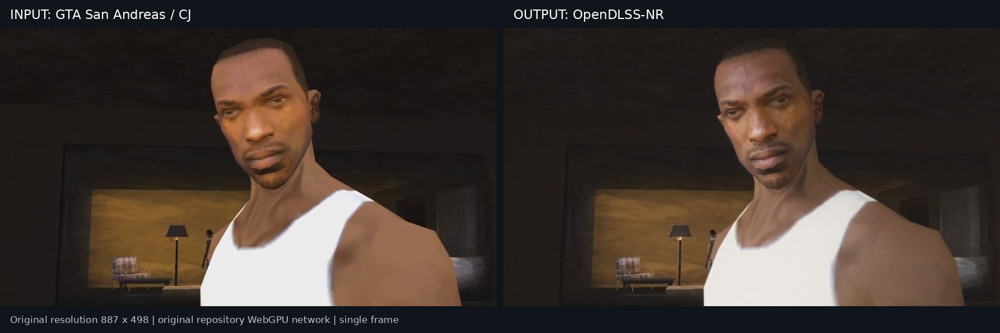
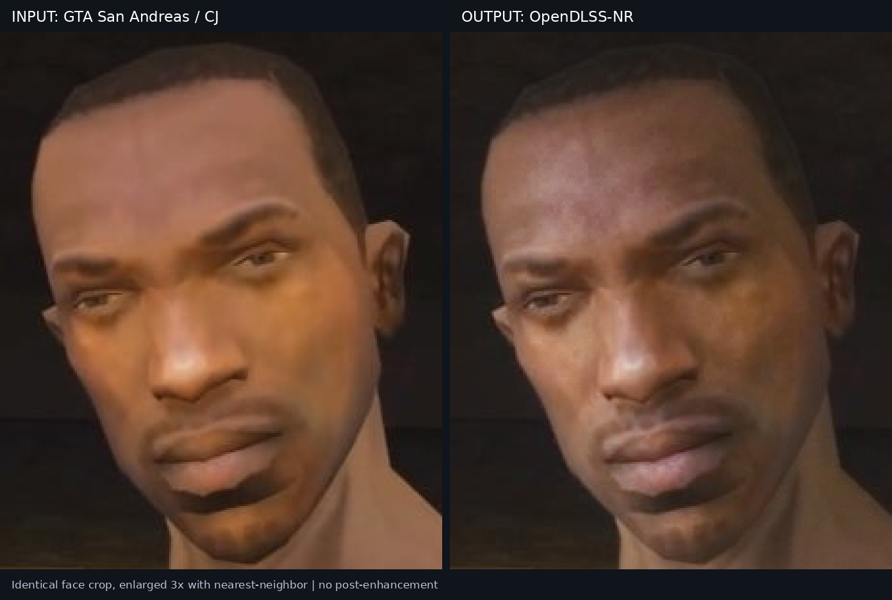

# GTA: San Andreas / CJ — single-image OpenDLSS-NR reproduction

This reproduction runs the repository's original **WebGPU network** on a real screenshot of Carl Johnson from *Grand Theft Auto: San Andreas*. It preserves the source image's 887 × 498 resolution. The image was not synthetically degraded or generated by an image model.

The output comes from the unmodified `Network`, WGSL kernels, and `composeImage` in [`ports/browser-webgpu`](../../ports/browser-webgpu). The files under `harness/` only provide image input, browser launching, result collection, and checks. This is the **71-block DLSS-NR 310.8.0.0 network**, not DLSS Super Resolution or the later 31-block model.

## Result

Left: the input. Right: the model output. The full-resolution input and output are also available separately as [`input.png`](artifacts/input.png) and [`output.png`](artifacts/output.png).



The face comparison uses the same rectangle on both images: `(360, 12, 590, 292)`. Both sides are enlarged 3× with nearest-neighbor sampling for display. The unscaled crops are [`face_input.png`](artifacts/face_input.png) and [`face_output.png`](artifacts/face_output.png).



## Recorded configuration

| Item | Value |
| --- | --- |
| Upstream | [`aloshdenny/open-dlss`](https://github.com/aloshdenny/open-dlss) |
| Upstream commit | `b9d4f7e8dc04a946a60207db73330177a586f1f1` |
| Model | DLSS-NR `310.8.0.0`, 71 blocks |
| Backend | Original repository WebGPU port, through Windows Edge |
| GPU | NVIDIA GeForce RTX 5070, 12 GB |
| Node.js | `24.22.1` |
| Input/output | 887 × 498 RGB |
| Internal padded field | 896 × 512 |
| Seed | `0` |
| Style | `0` |
| Local tone / structure | `1` / `1` |
| Skin structure | `-1` |
| Automatic mask | Enabled |
| Intensity | `1` |
| History | Single-frame initialization; history feature lanes equal the current frame; no temporal blend |
| Post-enhancement | None |

[`inference.json`](artifacts/inference.json) records the adapter, geometry, settings, memory allocations, timing, and checks. In the recorded launcher run, the first network execution took 207.2 ms and the second took 91.4 ms. These are browser-measured execution times on this setup, not a general benchmark or the native NVIDIA runtime's performance.

## Input provenance

The source is a published screenshot of CJ, not a photograph or a synthetic GTA-style face:

- [Eurogamer source article](https://www.eurogamer.pl/cj-z-san-andreas-nigdy-nie-bede-juz-wspolpracowal-z-rockstar-aktor-nie-pojawi-sie-w-gta-6).
- [Original image URL](https://assetsio.gnwcdn.com/cj-z-san-andreas-nigdy-nie-bede-juz-wspolpracowal-z-rockstar-aktor-nie-pojawi-sie-w-gta-6-1578037339323.jpg).
- Original downloaded JPEG: [`source_cj.jpg`](artifacts/source_cj.jpg).
- Transform: decode the JPEG to RGB, then save PNG at the original resolution.
- Hashes and crop coordinates: [`input_provenance.json`](artifacts/input_provenance.json).

The game image remains the property of its respective rights holders. The repository's code license does not relicense it.

## Verification and limits

- The browser-decoded input RGB matches the prepared input pixels.
- Output dimensions match the input. The output is nonblank and differs from the input.
- The head contains no nonfinite values. The recorded WebGPU error list is empty.
- Two executions with the **same prepared features** produced identical head bits: **0 mismatches across 1,835,008 float32 elements**. This covers repeated execution in this browser/GPU setup.
- **Native NVIDIA output parity was not tested.** No corresponding native output or author-provided capture for this GTA image was available. Repeated-output equality does not establish parity with NVIDIA.
- The launcher exited successfully, reproduced the recorded output PNG hash, closed its browser and server, and left its serving/debug ports closed. The path-free summary is included in `reproduction.json`.
- This reproduction covers one still image. It does not validate motion, temporal stability, or video quality.
- Input/output differences in the JSON files measure the amount of change. They are not quality scores against ground truth.

The output PNG SHA-256 is:

```text
29fdfdf1c6ad693d9e8b7df1aaddf2ae13483f61053a675a6307063889174e42
```

See [`output_checks.json`](artifacts/output_checks.json), [`reproduction.json`](artifacts/reproduction.json), and the WebGPU capability probe [`probe-runtime.json`](artifacts/probe-runtime.json).

## Reproduce

The launcher is intended for WSL with Windows Edge and an available hardware WebGPU adapter. It starts a local server, launches a separate browser profile, runs the image, and collects the result. Node.js must provide built-in `fetch` and `WebSocket`; this run used Node.js 24.22.1. Pillow and NumPy are only needed for input preparation and comparison export.

Run from this directory:

```bash
python3 -m venv .venv
.venv/bin/python -m pip install pillow numpy
```

Supply your own `nvngx_dlssnr.dll` as `runtime/nvngx_dlssnr.dll`. The original runtime and extracted model data are not included. This run used a third-party [310.8.0 mirror release](https://github.com/RankFTW/rhi-repo/releases/tag/dlssnr-310.8.0). Windows Authenticode reported a valid NVIDIA Corporation signature. The DLL was only read as data; it was not loaded or executed.

Expected DLL SHA-256:

```text
e16bcf15e16e13f527491cdf7845b2fe6521a738d8f7c9c721866a8496e1fc8e
```

Extract the original packed records without loading the DLL:

```bash
python3 scripts/packed_from_dll.py runtime/nvngx_dlssnr.dll models/nr
```

The exporter checks for 71 blocks and 153 records. It copies packed bytes into stage files and creates the manifest expected by the original WebGPU loader. It uses the PE/resource parser from [`mauri870/dlssnr-pytorch`](https://github.com/mauri870/dlssnr-pytorch), commit `3beef7935a8ef976b47ab78b906e75600c52d2de`; the parser and its [MIT license](scripts/vendor/dlssnr_LICENSE) are included under `scripts/vendor/`.

Run the network and export the comparisons:

```bash
node harness/run.mjs --image /artifacts/input.png --prefix single --repeat 2
.venv/bin/python scripts/build_comparison.py
```

`NR_WEIGHTS` overrides `models/nr`. `NR_ARTIFACTS` overrides `artifacts`. The server maps `/open-dlss/` to this fork's root, two levels above this directory; `NR_UPSTREAM` overrides that root. `EDGE` overrides the Windows browser executable path. The input and recorded output files in this directory are the original result bytes.

For a manual browser run:

```bash
node harness/server.mjs 8099
```

Open `http://localhost:8099/single.html?image=/artifacts/input.png&repeat=2` in a hardware-WebGPU browser. The capability probe is at `http://localhost:8099/probe.html`.

Only the source image, result images, metadata, and reproduction code are committed. Runtime binaries, extracted weights, raw heads, browser profiles, and local logs are excluded.
