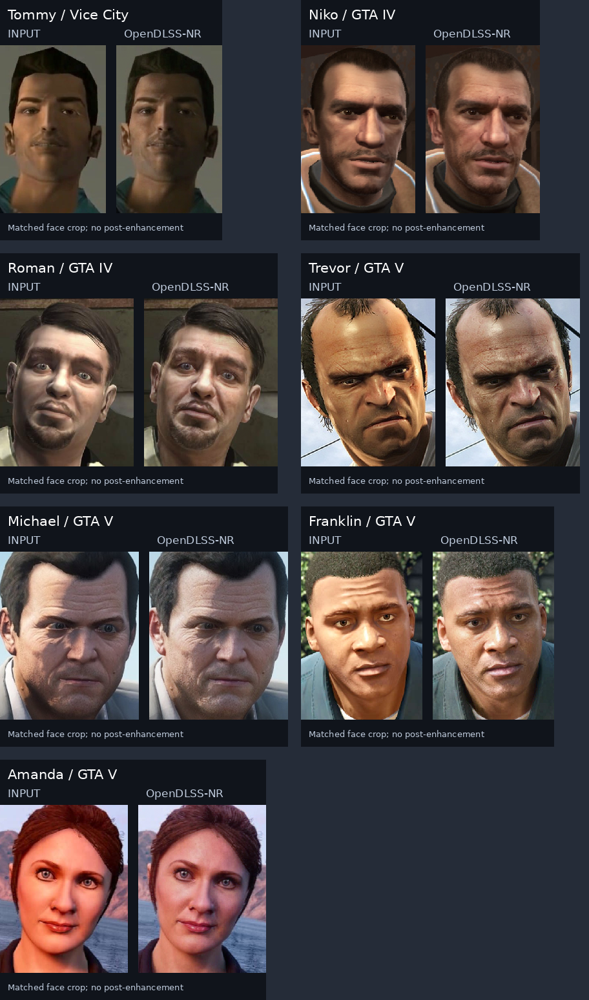
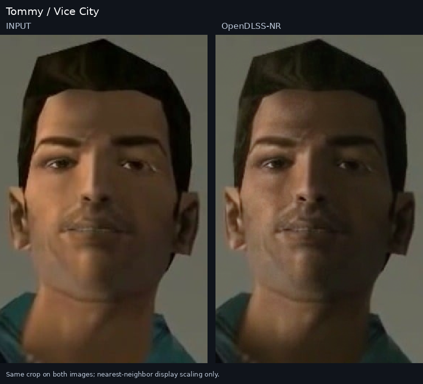
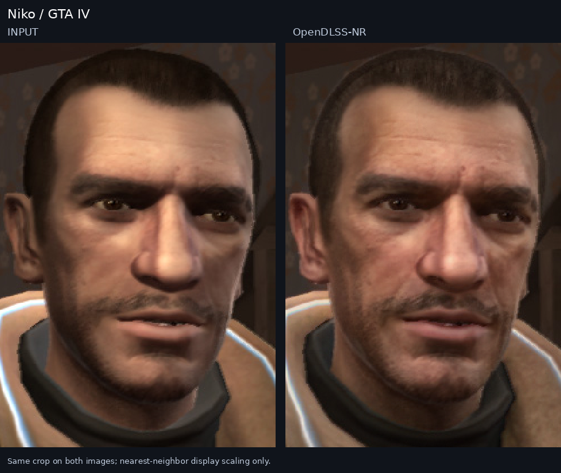
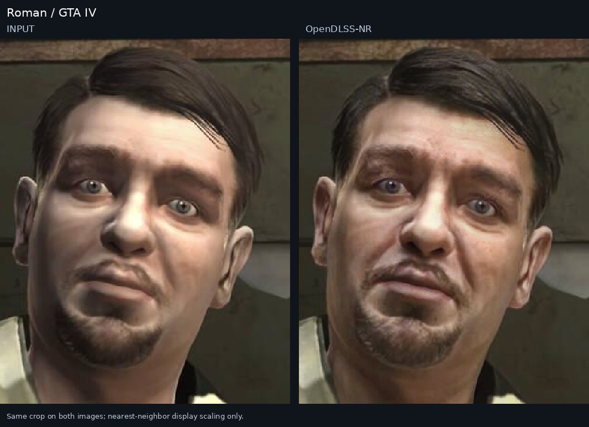
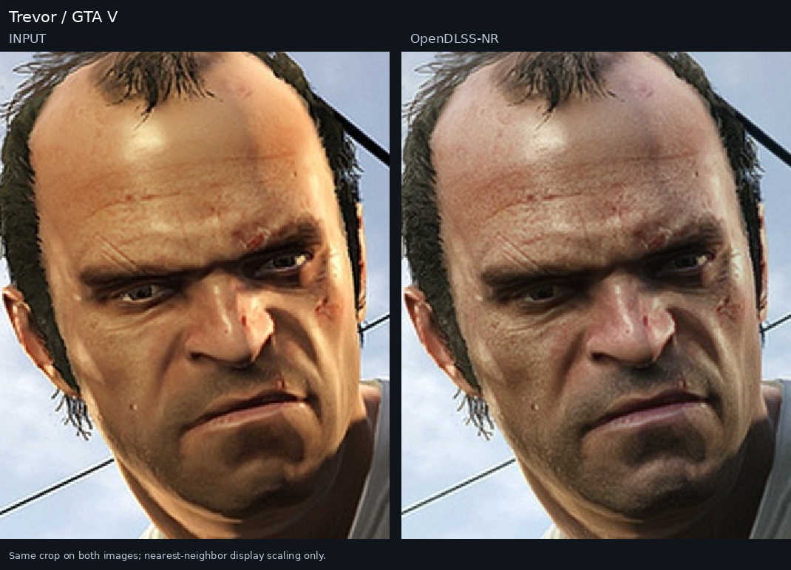
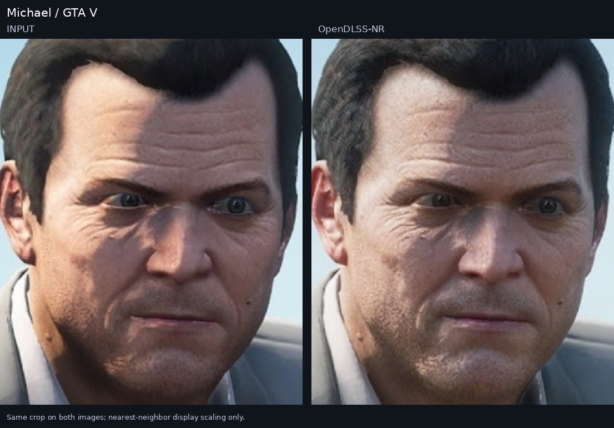
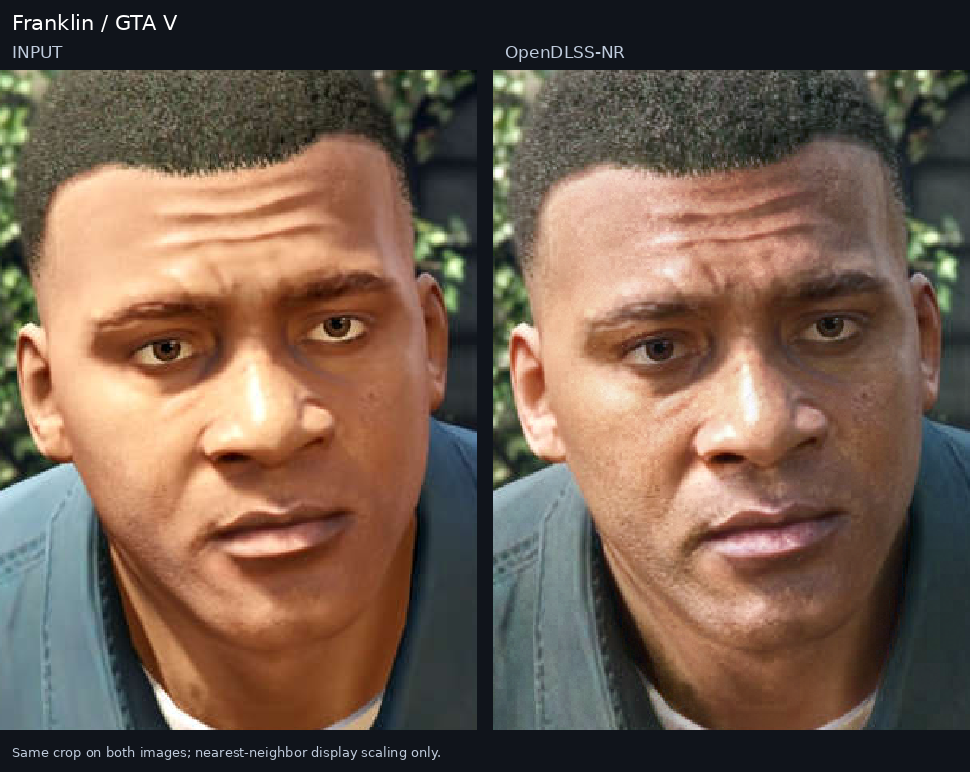
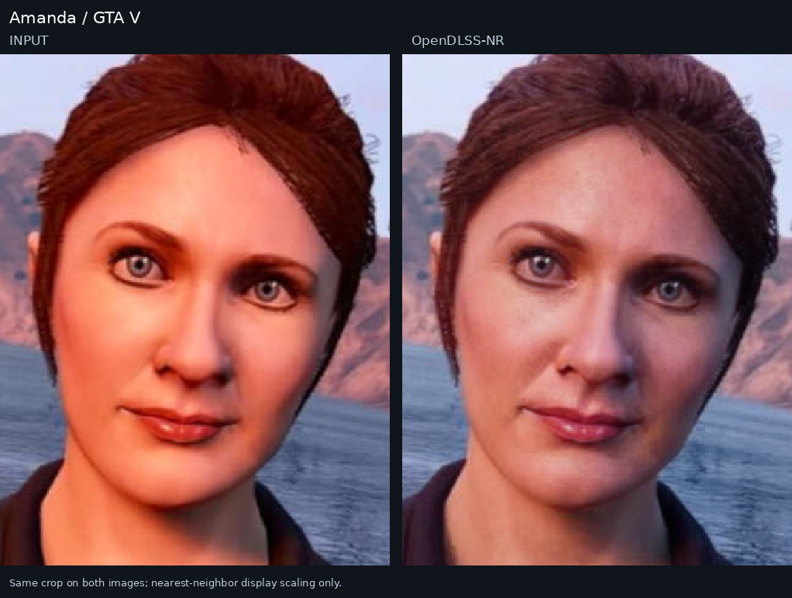

# Seven GTA faces — OpenDLSS-NR single-image examples

Seven fixed game-character screenshots were run through the repository's original **71-block DLSS-NR 310.8.0.0 WebGPU network**. All cases use the same model and controls. The input manifest was fixed before the batch; every listed case is retained, rather than selecting only favorable outputs.

The network and its WGSL kernels are unchanged in [`ports/browser-webgpu`](../../ports/browser-webgpu). The harness provides image loading, browser execution, output collection, and checks. This experiment runs pretrained NVIDIA weights; it does not train or fine-tune a model.

All **7 / 7 cases completed and passed the recorded checks**. Across the seven same-input repeat checks, 16,908,288 float32 head elements had zero bitwise mismatches. [Verification summary](verification_summary.json) · [Artifact hashes](artifact_manifest.json).

## Overview

Each card has the input on the left and the model output on the right. Both faces use the same crop. Display fitting uses nearest-neighbor sampling and does not add an enhancement pass.



## Inputs and source provenance

Input crops are in source-image coordinates `(left, top, right, bottom)`. Some large screenshots are cropped at their original pixel scale. **No input is rescaled before inference.** No synthetic degradation is applied. The original downloaded JPEG bytes are retained as each case's `source.jpg`.

| Case | Downloaded source | Model input/output | Input crop | Source page |
| --- | --- | --- | --- | --- |
| [Tommy / Vice City](#tommy-vice-city) | 1260 × 945 | 1024 × 832 | `[118, 48, 1142, 880]` | [Source](https://www.gtaboom.com/tommy-vercetti-ec14) |
| [Niko / GTA IV](#niko-iv) | 502 × 644 | 502 × 644 | `None` | [Source](https://www.grandtheftwiki.com/File:NikoBellic-GTAIV.jpg) |
| [Roman / GTA IV](#roman-iv) | 1200 × 675 | 1024 × 675 | `[100, 0, 1124, 675]` | [Source](https://vandal.elespanol.com/noticia/1350791728/gta-4-merece-un-remaster-segun-el-actor-de-roman-bellic-es-la-mejor-historia-de-gta/) |
| [Trevor / GTA V](#trevor-outdoor) | 780 × 438 | 780 × 438 | `None` | [Source](https://www.svg.com/326204/this-gta-online-ad-is-causing-a-frenzy/) |
| [Michael / GTA V](#michael-daylight) | 1600 × 900 | 1024 × 900 | `[200, 0, 1224, 900]` | [Source](https://www.svg.com/389710/the-most-bizarre-ways-you-can-play-gta-5/) |
| [Franklin / GTA V](#franklin-daylight) | 500 × 500 | 500 × 500 | `None` | [Source](https://www.voquent.com/blog/gta-5-voice-actors/) |
| [Amanda / GTA V](#amanda-sunset) | 500 × 500 | 500 × 500 | `None` | [Source](https://www.voquent.com/blog/gta-5-voice-actors/) |

[`batch/sources.json`](batch/sources.json) records the source pages, exact image URLs, source hashes, crop choices, and source-verification limits. [`batch/cases.json`](batch/cases.json) records the prepared inputs and hashes. Each result directory also contains `provenance.json` and `case.json`.

These are published game-image inputs, not newly captured game sessions. The sources do not consistently disclose capture build, platform, graphics settings, or editing history. Their specific limits are preserved in the provenance rather than treating visual inspection as proof of an unmodified game build. The images remain the property of their respective rights holders; the repository's code license does not relicense them.

## Common configuration

| Setting | Value |
| --- | --- |
| Upstream network commit | `b9d4f7e8dc04a946a60207db73330177a586f1f1` |
| Network | DLSS-NR 310.8.0.0, 71 blocks |
| Backend | Original repository WebGPU implementation, Windows Edge |
| GPU | NVIDIA GeForce RTX 5070, 12 GB |
| Seed / style | `0` / `0` |
| Local tone / local structure | `1` / `1` |
| Skin structure | `-1` |
| Automatic mask | Enabled |
| Intensity | `1` |
| History | Independent still frame; history features equal the current frame; no temporal blend |
| Post-enhancement | None |
| Repetition | Two executions with the same prepared features per case |

The batch summary is [`artifacts/more/batch_summary.json`](artifacts/more/batch_summary.json). Per-case `inference.json` files retain the actual adapter, padded geometry, dispatch count, memory allocations, settings, and measured execution times. Those timings describe this browser setup and are not a general benchmark or native NVIDIA runtime timings.

## Checks and limits

For each case, the runner checks the dimensions, browser-decoded input pixels, nonblank output, changed output, finite head, hardware adapter, and empty WebGPU error list. It also checks that two executions of the same prepared features produce identical float32 head bits. Actual results and element counts are recorded in each `checks.json`.

Same-input repeatability does **not** establish parity with NVIDIA's original runtime. No matching native NVIDIA output or original-author fixture is supplied for these seven images. The experiment covers independent still frames, not motion, temporal stability, or video quality. Input/output difference statistics measure the amount of change, not image quality against ground truth.

## Individual examples

### Tommy / Vice City

<a id="tommy-vice-city"></a>

[Input](artifacts/more/tommy_vice_city/input.png) · [Output](artifacts/more/tommy_vice_city/output.png) · [Full-frame comparison](artifacts/more/tommy_vice_city/comparison_full.png) · [Runtime](artifacts/more/tommy_vice_city/inference.json) · [Checks](artifacts/more/tommy_vice_city/checks.json) · [Provenance](artifacts/more/tommy_vice_city/provenance.json)



### Niko / GTA IV

<a id="niko-iv"></a>

[Input](artifacts/more/niko_iv/input.png) · [Output](artifacts/more/niko_iv/output.png) · [Full-frame comparison](artifacts/more/niko_iv/comparison_full.png) · [Runtime](artifacts/more/niko_iv/inference.json) · [Checks](artifacts/more/niko_iv/checks.json) · [Provenance](artifacts/more/niko_iv/provenance.json)



### Roman / GTA IV

<a id="roman-iv"></a>

[Input](artifacts/more/roman_iv/input.png) · [Output](artifacts/more/roman_iv/output.png) · [Full-frame comparison](artifacts/more/roman_iv/comparison_full.png) · [Runtime](artifacts/more/roman_iv/inference.json) · [Checks](artifacts/more/roman_iv/checks.json) · [Provenance](artifacts/more/roman_iv/provenance.json)



### Trevor / GTA V

<a id="trevor-outdoor"></a>

[Input](artifacts/more/trevor_outdoor/input.png) · [Output](artifacts/more/trevor_outdoor/output.png) · [Full-frame comparison](artifacts/more/trevor_outdoor/comparison_full.png) · [Runtime](artifacts/more/trevor_outdoor/inference.json) · [Checks](artifacts/more/trevor_outdoor/checks.json) · [Provenance](artifacts/more/trevor_outdoor/provenance.json)



### Michael / GTA V

<a id="michael-daylight"></a>

[Input](artifacts/more/michael_daylight/input.png) · [Output](artifacts/more/michael_daylight/output.png) · [Full-frame comparison](artifacts/more/michael_daylight/comparison_full.png) · [Runtime](artifacts/more/michael_daylight/inference.json) · [Checks](artifacts/more/michael_daylight/checks.json) · [Provenance](artifacts/more/michael_daylight/provenance.json)



### Franklin / GTA V

<a id="franklin-daylight"></a>

[Input](artifacts/more/franklin_daylight/input.png) · [Output](artifacts/more/franklin_daylight/output.png) · [Full-frame comparison](artifacts/more/franklin_daylight/comparison_full.png) · [Runtime](artifacts/more/franklin_daylight/inference.json) · [Checks](artifacts/more/franklin_daylight/checks.json) · [Provenance](artifacts/more/franklin_daylight/provenance.json)



### Amanda / GTA V

<a id="amanda-sunset"></a>

[Input](artifacts/more/amanda_sunset/input.png) · [Output](artifacts/more/amanda_sunset/output.png) · [Full-frame comparison](artifacts/more/amanda_sunset/comparison_full.png) · [Runtime](artifacts/more/amanda_sunset/inference.json) · [Checks](artifacts/more/amanda_sunset/checks.json) · [Provenance](artifacts/more/amanda_sunset/provenance.json)



## Reproduce

The included launcher targets WSL with Windows Edge and a hardware WebGPU adapter. This run used Node.js 24.22.1. Runtime binaries and extracted weights are not committed.

Run from this directory:

```bash
python3 -m venv .venv
.venv/bin/python -m pip install pillow numpy
```

Supply the 310.8.0.0 `nvngx_dlssnr.dll` as `runtime/nvngx_dlssnr.dll`. The preceding [CJ reproduction](../gta-cj-2026-10-27/README.md) documents its provenance and the weight extractor. Expected DLL SHA-256:

```text
e16bcf15e16e13f527491cdf7845b2fe6521a738d8f7c9c721866a8496e1fc8e
```

Extract the original packed weights using the included sibling experiment's parser, then prepare and run all fixed cases:

```bash
python3 ../gta-cj-2026-10-27/scripts/packed_from_dll.py runtime/nvngx_dlssnr.dll models/nr
.venv/bin/python batch/prepare_cases.py batch/sources.json
.venv/bin/python batch/run_batch.py batch/cases.json
```

The preparation script verifies downloaded JPEG hashes. Existing committed `source.jpg` files are reused. Each case runs independently; model output PNG bytes are copied unchanged. Private launch logs and raw heads use `batch/_work/` and are removed after successful checks. The runner's private artifact roots keep the original CJ result untouched.

To rebuild comparisons from existing saved model outputs, without inference:

```bash
.venv/bin/python batch/run_batch.py batch/cases.json --render-only
```

`--weights` selects another directory containing this same 71-block model. `NR_UPSTREAM` overrides the fork root used by the local server. `EDGE` overrides the Windows browser executable. No proprietary DLL, model weight, raw head, browser profile, or credential is included in this reproduction package.
