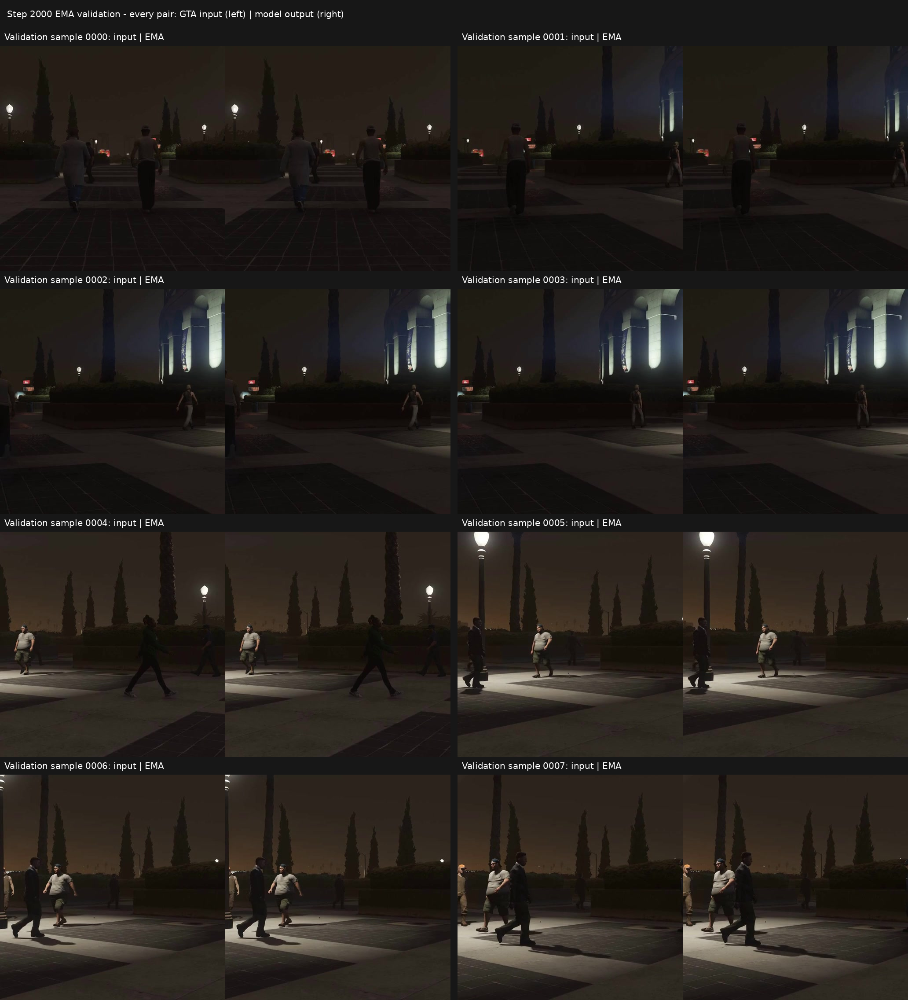

# GTAV → 实拍外观：第 2,000 步 EMA 验证对比

每组左侧为 GTAV 输入，右侧为 EMA 模型输出。每张单侧图像是 **512×512 固定验证裁剪**。下面总览中的图像保持原尺寸，只增加标题和间隔。

**目前外观变化仍很小，不能据此认定摄影真实性或画质已经提升。** 本次模型从第 0 步训练，使用完整 145,755,115 参数 NR、4×H800、BF16；每卡 batch 32，累积 1 次，有效 batch 128。GTAV 与 Sekai2 各选取 2 小时，按原始视频隔离训练和验证；两域不配对。

## 变化统计

| 统计范围 | 结果 |
| --- | --- |
| 保存的 8 张 8-bit PNG | 55,735 / 2,097,152 像素变化，约 **2.66%** |
| 变化定义 | 任一 RGB 通道与输入不同 |
| 变化幅度 | 绝大多数变化像素最大通道差为 1；全体最大差为 **3 个色阶** |
| 32 张验证裁剪的浮点平均绝对通道差 | 0.000760255 × 255 ≈ **0.193865 个色阶** |
| 验证内容保持检查 | 通过；语义不一致率 0，教师有效覆盖率约 92.49% |

8 张 PNG 的比例在量化到 8-bit 后计算；32 张验证图的平均差在量化前计算。两项统计的样本和量化口径不同，不能互相直接换算。变化幅度不是画质评分。外观代理距离为 0.01818785，也不是 FID 或真实感验证。

## 原尺寸对比图

| 验证图 | 输入与 EMA 输出 |
| --- | --- |
| 0000 | [打开 PNG](assets/0000.png) |
| 0001 | [打开 PNG](assets/0001.png) |
| 0002 | [打开 PNG](assets/0002.png) |
| 0003 | [打开 PNG](assets/0003.png) |
| 0004 | [打开 PNG](assets/0004.png) |
| 0005 | [打开 PNG](assets/0005.png) |
| 0006 | [打开 PNG](assets/0006.png) |
| 0007 | [打开 PNG](assets/0007.png) |

[验证指标](validation.json) · [逐图像素变化统计](pixel-change-summary.json) · [来源与文件 SHA256](manifest.json)
