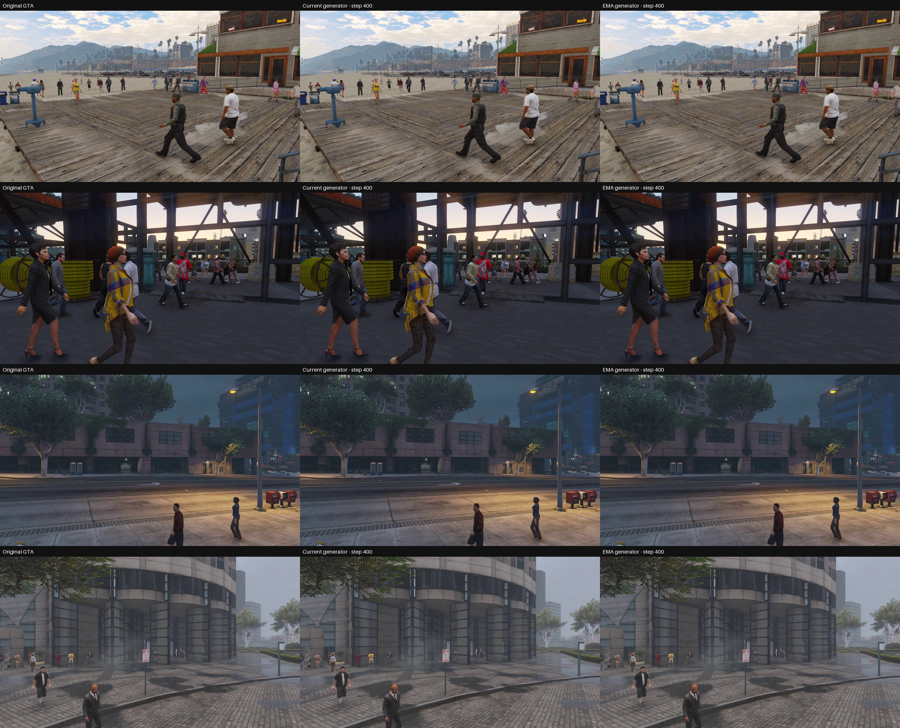

# GTAV → 实拍外观：第 400 步的 4 张生成测试图

左、中、右分别为原图、当前生成器、EMA 生成器。

完整 NR 生成器，145,755,115 参数。使用 NVIDIA H800、BF16，对 4 个不同原始视频的验证图进行推理。输入与单张输出均为 1344×768，没有缩放、分块或历史输入；只有上面的预览图缩小显示。

**这些是第 400 步的早期结果，尚无明显实拍外观转换。4 张图导出的当前/EMA 8-bit PNG 均与对应输入 PNG 完全相同。** 浮点输出存在很小的残差，四张当前权重输出的平均绝对变化约为 0.009–0.012 个 8-bit 灰度级；量化到 PNG 后被舍入。该差异不是画质评分。

| 原始视频 | 原图 | 当前生成器 | EMA | 完整对比图 |
| --- | --- | --- | --- | --- |
| gta:MOTSynth-576 | [PNG](assets/00/input.png) | [PNG](assets/00/current.png) | [PNG](assets/00/ema.png) | [三列对比](assets/00/comparison.png) |
| gta:MOTSynth-116 | [PNG](assets/01/input.png) | [PNG](assets/01/current.png) | [PNG](assets/01/ema.png) | [三列对比](assets/01/comparison.png) |
| gta:MOTSynth-354 | [PNG](assets/02/input.png) | [PNG](assets/02/current.png) | [PNG](assets/02/ema.png) | [三列对比](assets/02/comparison.png) |
| gta:MOTSynth-115 | [PNG](assets/03/input.png) | [PNG](assets/03/current.png) | [PNG](assets/03/ema.png) | [三列对比](assets/03/comparison.png) |

训练代码提交：[`6ee53f8`](https://github.com/rrui05/open-dlss/commit/6ee53f88d801baf9ba6accbe210d3e99eedfb4e9)。

checkpoint SHA256：`2f4672ed9a996915f2afb7605541a78609bcd358ae911f8f39e580cd91794747`。

[元数据及全部文件 SHA256](manifest.json)记录实际 checkpoint 步数、取样来源、原尺寸、推理设置与逐图差异。
