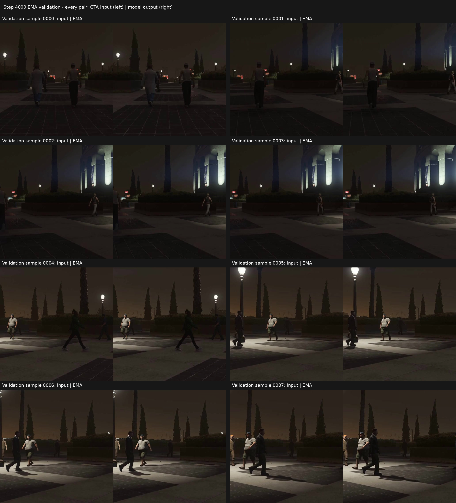

# GTAV → 实拍外观：第 4,000 步 EMA 验证对比

每组**左侧为 GTAV 输入，右侧为 EMA 输出**。单侧图像是 512×512 固定验证裁剪。总览保持原图像素，只增加标题和间隔。

本次从第 0 步训练完整 NR（145,755,115 参数），4×H800、BF16、每卡 batch 32、累积 1 次，有效 batch 128。GTAV 和 Sekai2 各选取 2 小时，两域无配对，训练与验证按原始视频隔离。

## 第 4,000 步的变化

| 统计范围 | 结果 |
| --- | --- |
| 保存的 8 张 PNG | 1,914,703 / 2,097,152 像素发生变化，约 **91.30%** |
| 变化定义 | 任一 RGB 通道与输入不同 |
| 变化像素的最大通道差中位数 | **2 个色阶**（0–255） |
| 全部像素中的最大通道差 | **33 个色阶** |
| 最大通道差 ≥5 的像素 | 5.01% |
| 32 张浮点验证图平均绝对通道差 | **2.373 个色阶** |
| 外观代理距离 | 第 3,000 步 0.018053 → 本次 0.01777476 |
| 语义不一致率 | 0.4642% |
| 内容保持检查 | 通过 |

这些是大范围的小幅变化。8 张 PNG 的统计在 8-bit 量化后计算；32 张验证图的平均差在量化前计算，两者口径不同。代理距离与像素变化都不能单独证明画质或摄影真实性已提升。

## 原尺寸图片

- [验证图 0000：左输入、右 EMA](assets/0000.png)
- [验证图 0001：左输入、右 EMA](assets/0001.png)
- [验证图 0002：左输入、右 EMA](assets/0002.png)
- [验证图 0003：左输入、右 EMA](assets/0003.png)
- [验证图 0004：左输入、右 EMA](assets/0004.png)
- [验证图 0005：左输入、右 EMA](assets/0005.png)
- [验证图 0006：左输入、右 EMA](assets/0006.png)
- [验证图 0007：左输入、右 EMA](assets/0007.png)

[验证指标](validation.json) · [逐图像素统计](pixel-change-summary.json) · [来源与 SHA256](manifest.json)

[第 2,000 步的同一组输入对比](https://github.com/rrui05/open-dlss/tree/results/gtav-sekai2-step2000-20261029/reproductions/gtav-sekai2-step2000-2026-10-29)
