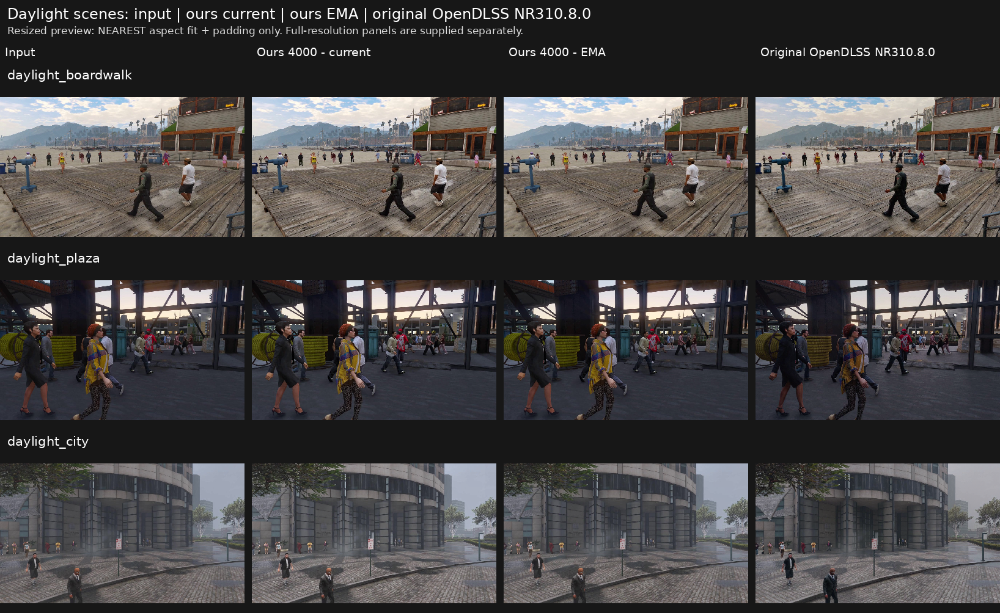
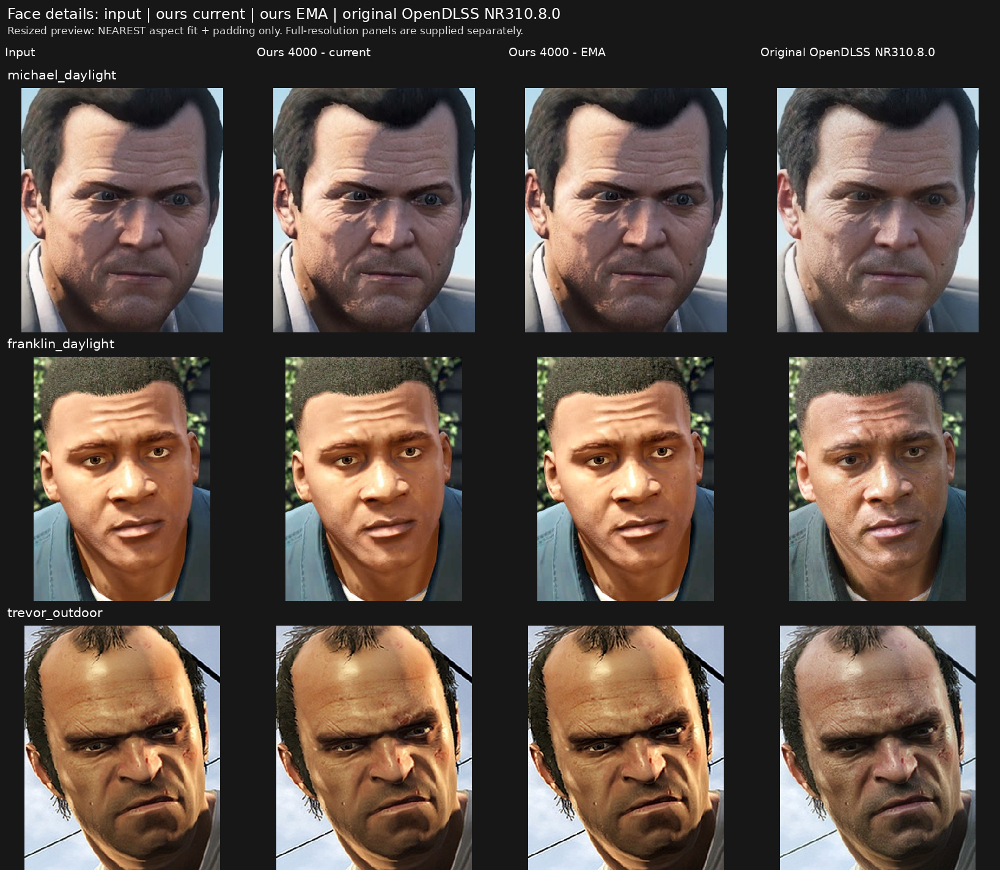

# 第 4,000 步：白天场景与人脸，和 OpenDLSS 原版 NR 同图对比

四列从左到右：**输入｜我们第 4,000 步当前权重｜我们第 4,000 步 EMA｜OpenDLSS 原版 NR 310.8.0**。

这次选取 3 张白天场景和 3 张清晰 GTA V 人脸图。整张输入、每个模型的单张输出和完整四列对比均保留原尺寸。总览仅缩放显示；人脸放大采用相同裁剪框、最近邻 2× 放大，没有另做锐化、提亮或修图。

## 白天场景

## 人脸局部

目前我们第 4,000 步模型的变化主要较轻，原版 NR 对人脸纹理和明暗的改动更明显。像素变化大小不是画质评分，这些图也没有配对的实拍真值。

## 原尺寸图片和人脸放大

| 测试图 | 输入 | 我们 current | 我们 EMA | 原版 NR | 原尺寸四列 | 人脸 2× |
| --- | --- | --- | --- | --- | --- | --- |
| 白天海边木栈道 | [PNG](assets/daylight_boardwalk/input.png) | [PNG](assets/daylight_boardwalk/ours-current.png) | [PNG](assets/daylight_boardwalk/ours-ema.png) | [PNG](assets/daylight_boardwalk/opendlss-nr.png) | [对比图](assets/daylight_boardwalk/comparison-full.png) | — |
| 白天广场与行人 | [PNG](assets/daylight_plaza/input.png) | [PNG](assets/daylight_plaza/ours-current.png) | [PNG](assets/daylight_plaza/ours-ema.png) | [PNG](assets/daylight_plaza/opendlss-nr.png) | [对比图](assets/daylight_plaza/comparison-full.png) | — |
| 白天城市街景 | [PNG](assets/daylight_city/input.png) | [PNG](assets/daylight_city/ours-current.png) | [PNG](assets/daylight_city/ours-ema.png) | [PNG](assets/daylight_city/opendlss-nr.png) | [对比图](assets/daylight_city/comparison-full.png) | — |
| Michael 人脸 | [PNG](assets/michael_daylight/input.png) | [PNG](assets/michael_daylight/ours-current.png) | [PNG](assets/michael_daylight/ours-ema.png) | [PNG](assets/michael_daylight/opendlss-nr.png) | [对比图](assets/michael_daylight/comparison-full.png) | [放大图](assets/michael_daylight/comparison-face-2x.png) |
| Franklin 人脸 | [PNG](assets/franklin_daylight/input.png) | [PNG](assets/franklin_daylight/ours-current.png) | [PNG](assets/franklin_daylight/ours-ema.png) | [PNG](assets/franklin_daylight/opendlss-nr.png) | [对比图](assets/franklin_daylight/comparison-full.png) | [放大图](assets/franklin_daylight/comparison-face-2x.png) |
| Trevor 人脸 | [PNG](assets/trevor_outdoor/input.png) | [PNG](assets/trevor_outdoor/ours-current.png) | [PNG](assets/trevor_outdoor/ours-ema.png) | [PNG](assets/trevor_outdoor/opendlss-nr.png) | [对比图](assets/trevor_outdoor/comparison-full.png) | [放大图](assets/trevor_outdoor/comparison-face-2x.png) |

## 测试与来源

- 我们的模型：完整 145,755,115 参数 NR，从零训练到第 4,000 步。此次实际加载的 checkpoint 步数已经核验，current 和 EMA 来自同一 checkpoint；在 H800 上以 BF16 整图推理，无缩放、分块或历史输入。
- 原版 NR：本仓库 OpenDLSS WebGPU 实现，使用 310.8.0 原始 71-block 权重，在 RTX 5070 上实际执行。3 张白天场景重新推理，并检查输入像素一致、两次 head 位级一致与 GPU 错误；3 张人脸复用已验证的同输入原版输出。
- 控制值：style 0、tone 1、structure 1、skin -1、auto-mask 开启，输出强度 1。原版使用 Gaussian seed 0；我们的训练配置使用零噪声。这是模型效果对比，不是逐位等价或跨硬件性能比较。
- 白天场景来自按原始视频隔离的 GTAV 验证集，分别覆盖 MOTSynth-576、116、115。人脸沿用仓库已有的 GTA V 外部测试图；原始游戏构建和 mod 信息未提供，来源见对应记录。
- 训练继续运行。checkpoint 目录只保留 `latest.pt` 和 `selected.pt`，没有早于第 4,000 步的残留版本；本次推理用的临时引用已移除，没有另存模型副本。

[逐图变化与运行统计](comparison-metrics.json) · [训练模型推理记录](trained-inference.json) · [原始 GPU 完成记录](provenance/trained-raw-receipt.json) · [全部发布文件 SHA256](manifest.json)

checkpoint SHA256：`1ffa46fc9cc453c8fc86029b3fe922cf2f01630eb11663166da73c16d098628a`。

原版 71-stage 权重清单 SHA256：`2c0c920e3a10c3cb3e2c1ea4f94c26c325d9d644cfa57e971440d3a159346262`。

[Michael 输入来源](provenance/michael_daylight-input.json) · [Franklin 输入来源](provenance/franklin_daylight-input.json) · [Trevor 输入来源](provenance/trevor_outdoor-input.json) · [新增白天原版 NR 运行记录](provenance/opendlss-new-daylight-baselines.json)
